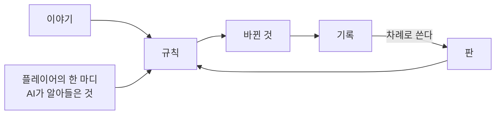
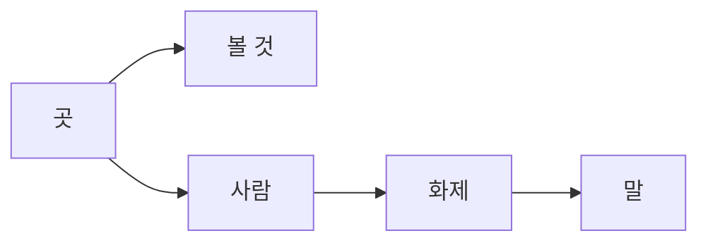
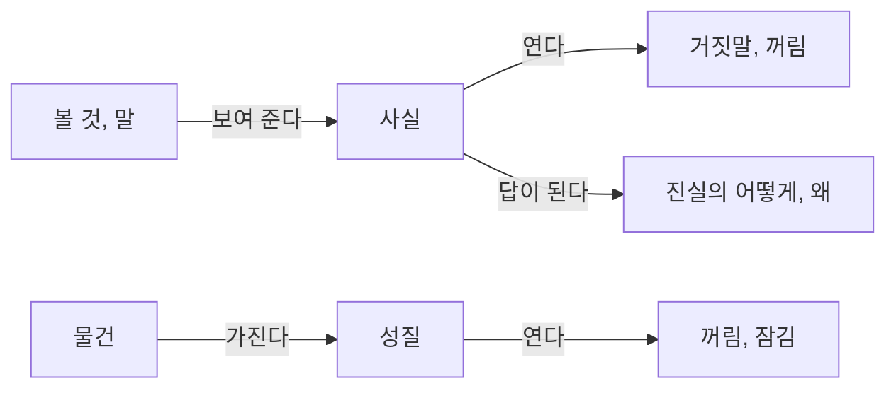

# 온톨로지

**이 게임의 세계에 무엇이 있고, 그것들이 서로 어떻게 이어지는가**를 정한다. 데이터 문서의 첫 문서이고, 나머지는 맨 끝의 "문서" 표에 있다.

플레이어가 겪는 것과 이야기에 적는 것은 [game/](../game/)이 정하고, 데이터 문서는 그것을 담는 그릇을 정한다. game 문서와 어긋나면 game 문서가 이긴다. 그때는 데이터 문서를 고친다. 낱말은 [game/03](../game/03-notebook.md)을 따르고, 보기는 [scenarios/dawn](../../scenarios/dawn/story.yaml)의 이야기다. 모델, 서버, 검사처럼 이 그릇을 움직이는 것은 [engine/](../engine/)이 정한다.

## 한눈에

- 세계는 **이야기**와 **판**으로 나뉜다. 이야기는 무엇이 있는지를 정하고 바뀌지 않는다. 판은 한 번의 놀이에서 무엇이 달라졌는지를 담는다.
- 이야기의 가운데에는 **사실과 성질**이 있다. 단서는 사실을 보여 주고, 단서로 여는 막힘은 사실이나 성질에 열린다.
- 판에 담기는 것은 대부분 플레이어가 **알아낸 것**과 **사람과의 사이**다. 세계의 모습이 달라지는 것은 번진 일뿐이다.
- **진실**은 이야기에 있고, **결론**은 판에서 고른다. 게임은 둘을 사실로 견준다.
- 판을 바꾸는 것은 **규칙뿐**이다. AI는 규칙이 내놓은 보기 가운데서 고르기만 한다.
- 저장하는 것은 **기록**이다. 판은 기록의 바뀐 것을 처음부터 차례로 써서 만든다. 같은 이야기, 같은 씨앗, 같은 기록이면 언제나 같은 판이 된다.

## 1. 있는 것

| 것 | 무엇인가 | 보기 |
|---|---|---|
| **사실** | 사건에 관한 참인 문장 하나 | *빈 사당*: 저녁 내내 사당에는 아무도 없었다 |
| **성질** | 물건의 특징 하나 | *가늘고 단단하다* |
| **곳** | 갈 수 있는 곳 | 마을 사당, 숲길, 여관 물레방아 |
| **볼 것** | 곳이나 잠긴 것 안에 놓인 것. 보기만 하는 것과 손에 드는 것(물건)이 있다 | 타지 않은 초, 쇠꼬챙이 |
| **사람** | 이야기 속 인물 | 고드릭, 마렌, 브람, 넬, 토빈 |
| **화제** | 한 사람이 사건에 관해 말할 수 있는 것 하나 | 브람의 "징수관" |
| **말** | 화제 하나의 말 한 가지. 갈래라고 부른다 | 브람.징수관의 거짓말, 깨진 뒤 |
| **막힘** | 앞을 가로막는 것. 화제에 걸린 거짓말과 꺼림, 볼 것에 걸린 잠김 | 브람의 거짓말, 토빈의 꺼림, 장부 궤짝 |
| **번진 일** | 정해진 때에 세계의 모습을 바꾸는 일 | 10칸째에 장부가 탄다 |
| **진실** | 누가(사람 하나), 어떻게, 왜(사실 하나씩) | 고드릭 / 독미나리 독 / 빼돌린 세금 |

플레이어인 김봉식은 이 목록에 없다. 이야기 속 사람이 아니라 판을 움직이는 쪽이다(3절).

## 2. 이어짐

세계는 두 가지로 엮인다. **무엇이 어디에 있는가**와 **무엇이 무엇을 여는가**다.

| 이어짐 | 뜻 | 보기 |
|---|---|---|
| **보여 준다** | 볼 것이나 말 하나가 사실 하나를 뒷받침한다. 둘 이상은 없다 | 여관 나무패 → *여관의 징수관* |
| **가진다** | 물건이 성질을 가진다 | 약초 칼 → *가늘고 단단하다* |
| **깬다** | 사실이 거짓말을 무너뜨린다. 깨는 사실이 여럿이면 그 가운데 하나로 깨진다 | *빈 사당* → 마렌의 "아버지는 사당에" |
| **바란다** | 꺼림이 사실이나 성질 하나를 바란다 | 토빈의 꺼림 → *조른 자국이 아니다* |
| **약점** | 잠김이 성질 하나에 열린다 | 장부 궤짝 → *가늘고 단단하다* |
| **있다** | 볼 것과 사람이 곳에 있다 | 넬 → 약초꾼 오두막 |
| **이어진다** | 곳에서 곳으로 갈 수 있다. 양쪽으로 간다 | 마을 사당 — 숲길 |
| **걸려 있다** | 화제에 거짓말이나 꺼림이, 볼 것에 잠김이 걸려 있다 | 고드릭.징수관 → 거짓말 |
| **품는다** | 잠긴 것 안에 볼 것이나 곳이 들어 있다 | 장부 궤짝 → 장부 두 벌 |
| **나온다** | 어떤 줄이 수첩에 있어야 곳, 볼 것, 화제가 나타난다 | 브람의 깨진 뒤 말 → 가방의 쪽지 |
| **알린다** | 줄의 글에 다른 곳이나 사람이 나온다 | 브람의 깨진 뒤 말 → 촌장 집 |

- **단서와 막힘은 서로를 직접 가리키지 않는다.** 언제나 사실이나 성질을 사이에 둔다. 그래서 "이 단서를 여기에 쓴다"는 어디에도 적히지 않고, 같은 사실을 보여 주는 단서가 늘면 길도 저절로 는다.
- **거짓말 갈래의 말은 아무것도 보여 주지 않는다.** 그래서 거짓말은 막힘을 열지 못하고, 나오는 조건도 되지 못한다.
- **사람은 틀리게 알지 않는다.** 참인 말은 사실을 보여 주고, 거짓말은 알면서 덮는 것이다. 잘못 알고 하는 말은 세계에 없다.
- 막힘은 주사위로도 열린다(game/05). 주사위는 이어짐이 아니라 규칙이므로 이 표에 없다.

## 3. 판에 담기는 것

판은 이야기의 것을 이름으로 가리키기만 하고, 새것을 만들지 않는다. 이야기에 없는 것을 알아내거나 바꿀 수는 없다.

| 묶음 | 담는 것 | 무엇이 바꾸는가 |
|---|---|---|
| **알아낸 것** | 수첩의 줄(곳, 사람, 볼 것, 말), 그은 줄, 표시, 읽은 줄 | 들어서기, 둘러보기, 묻기, 막힘 열기, 걸기 |
| **사람과의 사이** | 열린 막힘, 태도, 닫힌 방식, 통하지 않은 내밀기, 대화 셈, 말하는 상대 | 묻기, 내밀기, 걸기 |
| **흐른 것** | 쓴 칸, 지금 곳, 가 본 곳, 둘러본 곳 | 옮기기, 둘러보기, 걸기, 틀린 내밀기 |
| **번진 것** | 정해진 번진 일, 사람이 있는 곳, 떠난 사람, 없어진 볼 것 | 시간 |
| **결론** | 사람 줄 하나, 단서 줄 둘. 비울 수 있다 | 결론 내기 |

- 그 밖에 판 전체에 하나씩 있는 **바탕**이 있다. 씨앗, 턴, 능력치다(03 1절).
- **알아낸 것은 늘기만 한다.** 줄은 그어질 뿐 지워지지 않는다.
- **사람과의 사이는 판마다 다르다.** 같은 브람이라도 이번 판에서 거짓말이 깨졌는지, 플레이어를 얼마나 믿는지는 판이 담는다. 열린 막힘은 다시 닫히지 않고, 태도만 오르내린다.
- **번진 것만 세계의 모습을 바꾼다.** 그것도 번진 일 세 가지(떠난다, 옮긴다, 없어진다)뿐이다. 이미 적힌 줄은 그대로 남는다.

## 4. 진실과 결론

- 진실은 이야기에 있다. 사람 하나와 사실 둘이다.
- 결론은 판에서 고른다. 누가는 수첩의 사람 줄, 어떻게와 왜는 수첩의 단서 줄이다.
- 게임은 고른 줄이 **보여 주는 사실**을 진실의 사실과 견준다. 같은 사실을 보여 주는 줄이면 어느 것이든 맞다. 정답은 줄 하나가 아니라 사실 하나다.

## 5. 세계를 굳혀 두는 까닭

이 게임의 놀이는 **알아내고, 사람의 입을 여는 것**이다. 행동은 세계를 옮겨 놓지 않는다. 그래서 세계는 이야기로 굳혀 두고, 판에는 3절의 다섯 묶음만 둔다. 바뀔 수 있는 것이 적고 정해져 있으니, 규칙이 낸 결과를 검사하기도 쉽다.

## 문서

| 문서 | 정하는 것 |
|---|---|
| [01 온톨로지](01-ontology.md) | 세계에 무엇이 있고 서로 어떻게 이어지는가. 판에 무엇이 담기는가 |
| [02 이야기](02-story.md) | 이야기 파일에 무엇이 어떤 모양으로 들어 있는가. 무엇이 무엇을 가리키는가 |
| [03 판](03-state.md) | 한 판에서 바뀌는 것. 저장하는 것과 셈해서 얻는 것 |
| [04 바꾸는 일](04-change.md) | 판을 바꾸는 방법의 목록. 한 마디를 처리하는 차례 |
| [05 지키는 것과 저장](05-save.md) | 언제나 참이어야 하는 것. 저장 파일, 다시 돌리기, 판본 |
