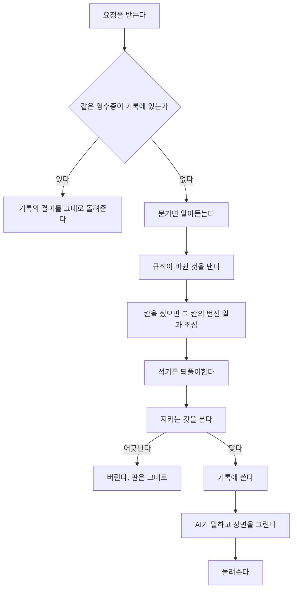

# 바꾸는 일

**판 상태를 바꾸는 방법**과 **한 마디를 처리하는 차례**를 정한다. 무엇이 통하고 무엇이 드는지는 [game/05](../game/05-blocks.md)와 [game/06](../game/06-time.md)이 정한다. 이 문서는 그 결과를 판 상태에 적는 법만 정한다.

## 한눈에

- 판 상태는 **바뀐 것**으로만 바뀐다. 바뀐 것의 종류는 1절의 목록이 전부다.
- 한 마디는 **행동** 하나가 된다. 규칙이 행동을 받아 바뀐 것의 목록을 낸다.
- 규칙은 **순수하다.** 같은 판 상태, 같은 이야기, 같은 행동이면 언제나 같은 목록을 낸다. 주사위도 씨앗과 턴에서 나온다.
- AI는 행동을 **고르기만** 한다. 바뀐 것을 내지 못한다.

## 1. 바뀐 것

| 바뀐 것 | 담는 것 | 판 상태(03 1절)에서 |
|---|---|---|
| **능력치를 정한다** | 넷의 값 | 능력치. 시작할 때 한 번만 |
| **칸을 쓴다** | 없다. 한 칸이다 | 쓴 칸이 하나 는다 |
| **옮긴다** | 곳 | 지금 곳이 바뀌고, 가 본 곳에 더한다 |
| **둘러본다** | 곳 | 둘러본 곳에 더한다 |
| **적는다** | 줄 주소 | 수첩 끝에 더한다 |
| **줄을 긋는다** | 말 주소 | 그은 줄에 더한다 |
| **아낀다** | 꺼림 주소 | 말을 아낀다에 더한다 |
| **아끼지 않는다** | 꺼림 주소 | 말을 아낀다에서 뺀다 |
| **실마리를 단다** | 꺼림이나 잠김 주소 | 실마리에 더한다 |
| **가려 낸다** | 말 주소, 숨기는 것이 있다 또는 거짓이 아니다 | 가려 낸 말에 더한다 |
| **연다** | 막힘 주소 | 열린 막힘에 더한다 |
| **방식을 닫는다** | 겨눈 것의 주소, 방식 | 닫힌 방식에 더한다 |
| **내밀기가 통하지 않았다** | 줄, 상대, 그때 상대에게 걸려 있던 막힘들 | 통하지 않은 내밀기에 적는다 |
| **태도가 바뀐다** | 사람, 믿음 또는 두려움, 오르거나 내린다 | 태도. 끝 단계면 그대로 |
| **번진 일이 정해진다** | 번진 일, 벌어졌다 또는 막았다 | 번진 일 |
| **떠난다** | 사람 | 떠난 사람에 더한다 |
| **사람이 옮긴다** | 사람, 곳 | 사람의 곳 |
| **없어진다** | 볼 것 | 없어진 것에 더한다 |
| **센다** | 사람, 화제 또는 넘김, 새 값 | 대화 셈 |
| **다 말했다** | 사람 | 대화 셈에 그 사람이 다 말했다고 적는다 |
| **상대를 고른다** | 사람이나 없음 | 말하는 상대 |
| **읽는다** | 줄 주소 목록 | 읽은 줄에 더한다 |
| **결론을 낸다** | 누가, 어떻게, 왜. 각각 비울 수 있다 | 결론 |

- 바뀐 것은 하나씩 차례로 쓰인다. 한 마디의 바뀐 것을 다 쓰면 05 1절의 지키는 것을 본다. 거짓말이 깨질 때의 "연다"와 "줄을 긋는다"처럼 함께 써야 맞는 것이 있기 때문이다. 어긋나면 규칙의 잘못이다. 그 한 마디 전체를 버리고 판은 그대로 둔 채 잘못으로 알린다.
- **지우는 바뀐 것은 없다.** 모음에서 빼는 것은 "아끼지 않는다"뿐이다. 값을 바꾸는 것은 태도, 지금 곳, 사람의 곳, 대화 셈, 말하는 상대다. 수첩의 줄, 열린 막힘, 정해진 번진 일은 빠지지 않는다.
- **턴**은 바뀐 것이 아니다. 한 마디가 기록에 쓰일 때 하나 는다(5절).

## 2. 행동

한 마디는 아래 행동 가운데 하나가 된다. 묻기만 AI가 알아듣고, 나머지는 화면의 누르기가 그대로 행동이 된다(game/07).

- **능력치 고르기가 첫 행동이다.** 그 전에는 다른 행동을 받지 않는다.
- **할 수 없는 행동은 받지 않는다.** 이곳에 없는 사람에게 내밀기, 닫힌 방식으로 걸기, 나오지 않은 곳으로 옮기기 같은 것이다. 판도 턴도 그대로다.

| 행동 | 담는 것 | 누가 만드는가 |
|---|---|---|
| **묻기** | 말하는 상대, 플레이어의 문장 | 화면. 무엇을 물었는지는 AI가 알아듣는다 |
| **옮기기** | 곳 | 화면, 또는 묻기를 알아들은 결과 |
| **둘러보기** | 없음 | 화면, 또는 묻기를 알아들은 결과. 상대 없이 쓴 묻기도 둘러보기다 |
| **내밀기** | 단서의 줄 주소, 내미는 대상(사람이나 잠김), 곁들인 말 | 화면 |
| **걸기** | 겨눈 것의 주소, 방식, 곁들인 말 | 화면 |
| **상대 고르기** | 사람이나 없음 | 화면 |
| **수첩 읽기** | 줄 주소 목록 | 화면 |
| **능력치 고르기** | +2와 +1을 줄 능력치 | 화면. 시작할 때만 |
| **결론 내기** | 누가, 어떻게, 왜 | 화면 |

### 알아듣기

묻기의 문장은 규칙이 만든 **보기** 가운데 하나로 바뀐다.

| 보기 | 되는 것 |
|---|---|
| 상대의 나온 화제 하나하나 | 그 화제를 묻는다. 둘이면 둘 다 차례로 |
| 갈 수 있는 곳 하나하나 | 옮기기 |
| 잡담 | 잡담 |
| 고른 것의 확실함이 문턱보다 낮다 | 되묻기. 헷갈리는 화제의 이름을 함께 고른다 |
| 답할 것이 없다 | 넘김 |

- AI는 보기의 이름만 받고, 보기 가운데서만 고른다. 보기에 없는 것을 돌려주면 확실함이 낮은 것으로 다룬다. 묻는 법과 문턱은 engine/01 1절이 정한다.
- 상대가 없으면 화제의 보기도 없다. 상대 없이 쓴 묻기는 둘러보기다(game/07 2절).

## 3. 행동마다 나오는 바뀐 것

| 행동 | 나오는 바뀐 것 |
|---|---|
| **묻기: 화제** | 화제의 지금 자세(03 2절)에 따라. 숨기지 않는다: 그 화제의 참말, 풀린 뒤, 깨진 뒤 가운데 지금의 말을 적는다. 거짓말한다: 거짓말을 적는다. 꺼린다: 아낀다. 이미 수첩에 있거나 붙어 있으면 다시 하지 않는다. 언제나: 센다(그 화제), 센다(넘김, 0) |
| **묻기: 다 말했다** | 운을 뗄 화제가 남지 않아 "다 말했다"고 할 때다. 처음이면 다 말했다. 아직 표시가 없는 꺼리는 나온 화제마다 아낀다(game/04 5절) |
| **묻기: 넘김** | 센다(넘김). 셋째면 대답이 운 떼기로 바뀔 뿐 바뀐 것은 같다. 같은 화제를 세 번째 물을 때도 그렇다(game/04 5절) |
| **묻기: 잡담, 되묻기** | 없다 |
| **둘러보기** | 지금 곳을 처음 둘러보면 둘러본다, 적는다(4절). 다시 둘러보면 바뀐 것이 없고 장면만 나온다 |
| **옮기기** | 지나는 곳마다: 칸을 쓴다, 옮긴다, 그곳에 들어서서 적는 것(4절). 닿은 곳에 사람이 하나면 그 사람으로, 아니면 없음으로 상대를 고른다. 가장 짧은 길로 가는 것은 한 칸씩 옮기는 것과 같아서, 한 칸마다 그 칸의 번진 일과 조짐(5절 4)을 본다. 가는 중에 칸이 다 되면 그 자리에서 멈춘다 |
| **내밀기: 맞닿는다** | 맞닿은 막힘마다 연다. 거짓말: 들었으면 줄을 긋는다, 적는다(깨진 뒤), 태도(두려움이 오른다). 꺼림: 아끼지 않는다, 적는다(풀린 뒤), 태도(믿음이 오른다). 잠김: 안에 든 것이 나와 적힌다 |
| **내밀기: 안 맞닿는다** | 칸을 쓴다. 사람에게 내밀었으면 센다(넘김) |
| **걸기** | 칸을 쓴다. 성공: 들은 말이면 가려 낸다, 꺼림과 잠김이면 연다와 그 뒤의 것. 실패: 방식을 닫는다, 꺼림과 잠김이면 실마리를 단다. 태도는 game/05 4절의 표대로 |
| **상대 고르기** | 상대를 고른다 |
| **수첩 읽기** | 읽는다 |
| **결론 내기** | 결론을 낸다 |

- **다 말한 사람과 다시 말할 때**, 곧 그 사람에게 묻거나 내밀거나 그 사람의 말이나 꺼림에 걸 때는 맨 먼저, 아직 표시가 없는 꺼리는 나온 화제마다 아낀다. 다 말한 뒤에 나온 꺼리는 화제가 이렇게 표시된다(game/04 5절).
- **주사위의 눈**은 씨앗과 이번 한 마디의 턴(판 상태의 턴 + 1)에서 나온다. 같은 판에서 같은 턴을 다시 처리해도 같은 눈이 나온다.
- 내밀기와 걸기에 곁들인 말은 대답의 말투에만 쓰고 바뀐 것에는 들어가지 않는다.

## 4. 적기

곳에 들어서거나 둘러보거나, 줄이 하나 적히거나, 잠김이 열리면 아래를 **더 늘지 않을 때까지** 되풀이한다.

1. 지금 곳이 둘러본 곳이면, 그곳의 나온 볼 것 가운데 수첩에 없는 것을 적는다. 잠긴 것 안에 든 볼 것은 그 잠긴 것이 있는 곳의 것으로 친다.
2. 이곳의 사람 가운데 수첩에 없는 사람을 적는다.
3. 지금 곳과, 지금 곳과 이어진 나온 곳 가운데 수첩에 없는 곳을 적는다.
4. 방금 적힌 줄이 **알리는 것**(02 2절)의 곳과 사람 가운데 수첩에 없는 것을 적는다.

적힌 차례가 곧 수첩의 차례이고, 한 번의 일로 적힌 것은 화면에서 알림 한 줄로 묶인다(game/07).

## 5. 한 마디를 처리하는 차례

1. **받는다.** 요청마다 영수증이 있다. 같은 영수증이 기록에 있으면 처리하지 않고 기록의 결과를 돌려준다(05).
2. **알아듣는다.** 묻기만이다(2절).
3. **바뀐 것을 낸다.** 3절대로.
4. **시간.** 칸을 쓸 때마다 그 칸에 정해진 번진 일을 본다. 그때 막는 조건의 막힘이 열려 있으면 막았다로 정한다. 이번 한 마디에 열린 것도 친다(game/06 2절). 아니면 벌어졌다로 정하고 그 일의 바뀐 것을 더한다. 말하는 상대가 떠나거나 다른 곳으로 옮기면 상대를 고른다(없음)도 더한다. 이어서 세 칸 뒤에 올 번진 일의 막는 조건이 아직 채워지지 않았으면 조짐을 일어난 일에 더한다. 조짐은 판 상태를 바꾸지 않는다.
5. **적는다.** 4절대로.
6. **본다.** 05 1절의 지키는 것이 모두 참인지 본다.
7. **기록한다.** 턴을 하나 올리고, 이 턴의 행동, 주사위의 눈, 바뀐 것, 일어난 일을 기록에 한꺼번에 쓴다. 여기까지 끝나야 판이 바뀐 것이다.
8. **말하게 한다.** 03 3절의 것만 AI에게 준다. AI의 글은 기록의 그 턴에 덧붙지만 판 상태에는 닿지 않는다.

- **글이 오지 않아도 판은 이미 바뀌었다.** 화면이 같은 영수증으로 다시 보내면 기록의 결과에 글만 다시 받는다.
- **칸이 다 되면** 그 한 마디의 결과까지만 처리하고, 다음 요청부터는 수첩 읽기와 결론 내기만 받는다.
- **결론이 있으면** 어떤 요청도 판을 바꾸지 않는다.
