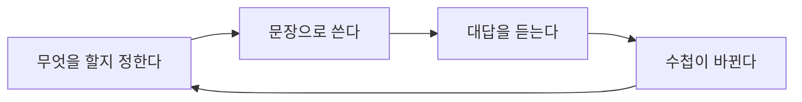
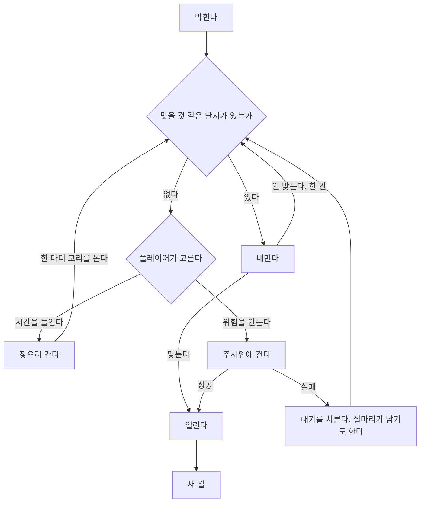

# 핵심 루프

**플레이어가 무엇을 반복하는가**만 정한다. 각 단계의 규칙은 뒤의 문서가 정한다. 낱말은 [03-notebook.md](03-notebook.md)를 따른다.

## 한눈에

플레이어는 세 겹의 고리를 돈다. 작은 고리가 여러 번 돌아 큰 고리 하나가 된다.

| 고리 | 길이 | 하는 일 | 정하는 것 | 얻는 것 |
|---|---|---|---|---|
| **한 마디** | 짧다 | 쓰고, 듣는다 | 누구에게 무엇을 물을까 | 대답. 때로 수첩 한 줄 |
| **막힘 하나** | 몇 분 | 막힌 곳을 뚫는다 | 내밀까, 찾으러 갈까, 걸까 | 새로 열린 길 |
| **한 판** | 1시간쯤 | 사건을 밝힌다 | 어디에 시간을 쓸까, 언제 결론을 낼까 | 결말 |

고리마다 플레이어가 **정하는 것**이 있어야 한다. 정할 것이 없는 구간은 놀이가 아니라 기다림이다.

## 1. 한 마디

사람과 말을 주고받는 느낌이어야 한다.

- **쓰면 반드시 대답이 온다.** 수첩에 적힐 것이 없어도 그 사람은 대답한다.
- **수첩이 바뀌면 바로 보인다.** 새 줄이 한 마디의 보상이다.
- **기다림은 짧다.** 대답이 시작되기까지 몇 초를 넘지 않는다.

## 2. 막힘 하나

누군가 거짓말을 하거나, 말을 아끼거나, 어딘가 잠겨 있다.

| 길 | 드는 것 | 얻는 것 |
|---|---|---|
| 단서를 내민다 | 맞으면 없다. 틀리면 한 칸 | 맞으면 반드시 열린다 |
| 찾으러 간다 | 시간. 옮길 때마다 든다. 들어서면 그곳의 것이 모두 적힌다 | 단서가 늘 수 있다. 다른 막힘의 열쇠가 같이 나오기도 한다 |
| 주사위에 건다 | 시간, 실패의 대가 | 성공하면 지금 열린다. 거짓말은 깨지지 않고, 거짓말인지 아닌지만 안다. 꺼림과 잠김은 실패해도 실마리가 남는다 |

- **수첩을 보며 궁리하는 순간**이 이 게임에서 머리를 가장 많이 쓰는 때다.
- **찾으러 갈지 걸지는 플레이어가 정한다.** 규칙이 가르지 않는다. 이 게임의 중심 결정이다.
- **열리면 넓어진다.** 새 화제, 새 장소, 새 단서 중 하나 이상이 나오고, 그것이 다음 막힘으로 이어진다.

지켜야 할 것:

- **막혔다는 것을 안다.** 말을 아끼는 것과 잠긴 것은 플레이어가 알 수 있다. 거짓말은 먼저 알려 주지 않는다. 플레이어가 어긋남으로 알아챈다.
- **갈 곳이 늘 하나는 있다.** 모든 길이 한 막힘에 걸리지 않게 쓴다.

## 3. 한 판

보통의 흐름이다. 전체는 1시간쯤이고, 가장 긴 구간은 파고들기다. 결론은 어느 구간에서든 낼 수 있다.

| 구간 | 플레이어가 하는 일 | 느낌 |
|---|---|---|
| **시작** | 사건을 듣고, 누가 있고 어디에 갈 수 있는지 안다 | 궁금하다 |
| **둘러보기** | 사람을 만나고 곳곳을 살핀다. 수첩이 빠르게 찬다 | 넓어진다 |
| **파고들기** | 어긋나는 것을 찾고 막힘을 뚫는다. 사건이 번진다 | 조여 온다 |
| **결론** | 수첩을 펴고 누가, 어떻게, 왜를 낸다 | 건다 |
| **결말** | 무엇을 밝혔고 그동안 무엇이 번졌는지 본다 | 풀린다 |

지켜야 할 것:

- **처음 몇 분 안에 손이 간다.** 긴 설명 없이 첫 질문을 쓸 수 있다.
- **수첩이 찰수록 할 일이 또렷해진다.** "무엇을 더 찾지?"가 "이걸 누구에게 내밀지?"로 바뀐다.
- **끝은 플레이어가 낸다.** 다 됐다고 느끼는 순간 결론을 낸다.
- **언제 결론을 내도 결말이 있다.** 다 밝히지 못해도 한 판은 이야기로 끝난다.

## 4. 긴장은 시간에서 온다

- **캐묻는 것은 공짜고, 헛걸음은 비싸다.**
- 시간이 가면 사건이 번진다. 예컨대 누군가 떠나거나, 아직 못 본 것이 없어진다.
- 그래서 뒤로 갈수록 같은 선택이 무거워진다. "한 군데 더 가 볼까"가 처음에는 공짜 같고 끝에는 도박이 된다.

## 5. 고리가 끊기는 곳

플레이어가 그만두는 순간은 대개 이 셋이다. 뒤의 문서는 이것을 막는 쪽으로 정한다.

| 끊기는 곳 | 모습 | 막는 방향 |
|---|---|---|
| **막막함** | 무엇을 해야 할지 모른다 | 말을 아끼는 사람, 잠긴 것, 아직 안 가 본 곳을 보여 준다 |
| **기다림** | 대답이 늦다 | 짧게 말한다 |
| **헛돎** | 써도 아무것도 안 바뀐다 | 같은 말을 되풀이하면 그 사람이 아직 안 한 화제의 운을 떼거나, 다 말했다고 한다(04) |

## 6. 크기 (가정)

한 판 1시간쯤에서 나온 어림이다. **해 보지 않은 숫자다.** 첫 이야기를 돌려 보고 고친다.

| 무엇 | 크기 | 근거 |
|---|---|---|
| 한 마디 | 100번 안팎 | 한 마디에 30초쯤 |
| 막힘 | 7~9개 | 한 판의 절반쯤을 막힘에 쓴다 |
| 사람 | 4~5명 | 한 사람에 막힘 하나나 둘 |
| 장소 | 4~6곳 | 옮길 때마다 시간이 가므로 적게 |
| 번진 일 | 2~3번 | 파고들기 구간에 고르게 |
