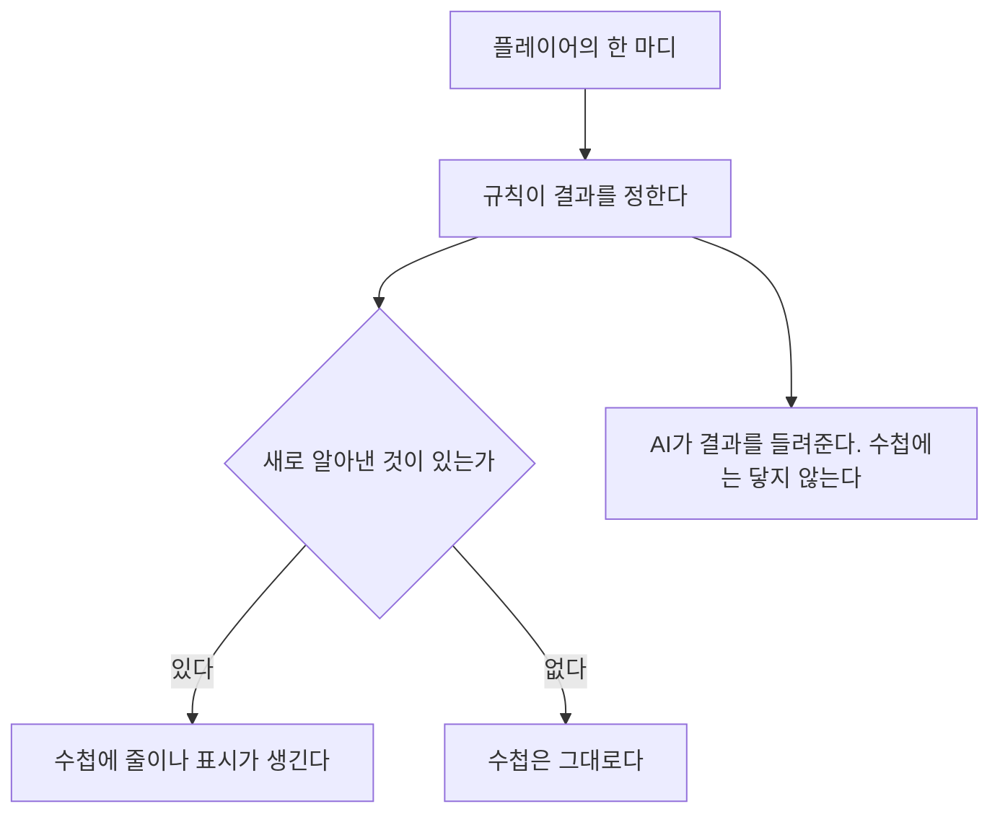

# 낱말과 수첩

**수첩에 무엇이 어떻게 적히는가**와, 모든 문서가 함께 쓰는 **낱말**을 정한다.

## 한눈에

- 수첩은 플레이어가 **알아낸 것의 목록**이다.
- 수첩에 적는 것은 **규칙뿐**이다. AI가 쓴 글은 수첩에 들어가지 않는다.
- 줄은 다섯 종류다: **곳, 사람, 물건, 본 것, 들은 말.**
- 줄에는 **표시**가 붙을 수 있다. 표시도 규칙만 붙인다.

> **곳** 마을 사당 · 숲길 · 여관 물레방아 · 약초꾼 오두막(안 가 봄) · 촌장 집(안 가 봄)
> **사람** 고드릭 · 토빈 — *숲길에서 본 것은 말을 아낀다* · 브람
> **물건** 쇠꼬챙이
> **본 것** 제단의 초가 하나도 타지 않은 채 그대로였다 · 징수관의 목에 끈에 졸린 듯한 자국이 있었다 · 징수관의 입술이 검푸르게 변해 있었다 · 징수관의 허리띠에 여관 '물레방아'의 나무패가 달려 있었다
> **들은 말** 고드릭 "징수관은 해 지기 전에 장부만 걷고 바로 떠났다."
> **들은 말** ~~브람 "징수관은 여관에 오지도 않았다."~~
> **들은 말** 브람 "밀주를 들켜서 은화를 쥐여 줬다. 징수관은 장부를 맞추러 촌장 댁에 간다며 내게 가방을 맡겼다."

## 1. 줄

| 종류 | 무엇인가 | 언제 적히는가 |
|---|---|---|
| **곳** | 갈 수 있다고 알게 된 곳 | 지금 있는 곳과 이어져 있거나, 이름이 다른 줄에 나왔을 때. 가 봤는지가 함께 보인다 |
| **사람** | 이야기 속 인물 | 만났거나, 이름이나 부르는 말이 다른 줄에 나왔을 때 |
| **물건** | 손에 넣은 것 | 그것이 있는 곳을 둘러봤을 때 |
| **본 것** | 직접 보아 안 것 | 곳을 둘러봤을 때. 그곳에 나와 있는 것이 모두 적힌다 |
| **들은 말** | 사람이 화제에 관해 한 말 | 그 사람이 그 화제를 말했을 때. 누가 한 말인지와 함께 적힌다 |

- **수첩은 비어서 시작한다.** 들어서면 그곳의 사람과 이어진 곳만 적힌다. 놓인 것은 **둘러봐야** 적힌다. 둘러보기는 공짜다. 한 번 둘러본 곳은 다시 둘러봐도 장면만 다시 듣고, 그 뒤 그곳에 새로 나온 것은 바로 적힌다.
- **나중에 나온 것**(08의 나오는 조건)은 둘러본 곳에 있으면 바로, 아니면 다음에 그곳에 들어서거나 둘러볼 때 적힌다.
- **본 것은 언제나 참이다.** 본 때에 그랬다는 뜻이다. 나중에 달라져도 줄은 그대로다.
- **들은 말은 참이거나 거짓말이다.** 어느 쪽인지 수첩은 알려 주지 않는다. 깨지기 전의 거짓말은 여느 들은 말과 똑같이 보이고, 플레이어가 다른 줄과 어긋나는 것으로 알아챈다. 주사위에 걸어 얻어 낸 표시만 예외다.
- **잠긴 것은 본 것으로 적힌다.** "장부 궤짝이 잠겨 있었다." 열리면 안에 든 것이 그 자리에서 적힌다.
- **물건, 본 것, 들은 말을 합쳐 단서라고 부른다.** 내밀 수 있는 것은 단서뿐이다.
- 같은 것은 한 번만 적힌다. 같은 화제를 다시 물어 같은 대답을 들으면 새 줄이 생기지 않는다.

## 2. 표시와 줄 긋기

표시는 줄에 붙는 꼬리표다. 줄이 아니고, 내밀 수 없다.

| 표시 | 어디에 붙는가 | 뜻 |
|---|---|---|
| **안 가 봄** | 곳 | 아직 가지 않았다 |
| **말을 아낀다** | 사람, 화제 하나와 함께 | 그 화제를 알지만 말해 주지 않는다(04) |
| **열었다** | 본 것 | 잠겨 있던 것을 열었다 |
| **숨기는 것이 있다** | 들은 말 | 이 말은 거짓말이다. 주사위에 걸어 얻는다(05) |
| **거짓이 아니다** | 들은 말 | 이 말은 참이다. 주사위에 걸어 얻는다(05) |
| **실마리** | 사람, 본 것 | 그 막힘에 무엇을 내밀면 되는지 가리키는 한 마디(05) |
| **떠났다** | 사람 | 번진 일로 더는 만날 수 없다(06) |

- **줄 긋기**: 거짓말이 깨지면 그 들은 말에 줄이 그어진다. 지워지지는 않는다. 새로 한 말이 따로 적힌다.

## 3. 수첩이 지키는 것

- **적히지 않았으면 단서가 아니다.** 어떤 말을 듣고도 수첩에 줄도 표시도 생기지 않았다면, 그 말은 추리에 쓸 것이 아니다.
- **사라지지 않는다.** 주사위에 실패해도, 시간이 흘러 사건이 번져도 줄은 그대로다.
- **수첩만으로 닿는다.** 플레이어는 수첩에 적힌 것만 가지고 진실에 닿을 수 있다. 화면 밖의 기억이나 AI의 글에 기대지 않아도 된다.
- **바뀌면 바로 보인다.** 새 줄, 새 표시, 떨어진 표시, 그어진 줄은 생긴 순간에 알려 준다.
- **막힌 곳이 보인다.** 안 가 본 곳, 말을 아끼는 사람, 아직 열지 않은 잠긴 것은 수첩에서 찾을 수 있다.

## 4. 플레이어에게 안 보이는 것

이야기는 단서마다 그것이 **보여 주는 사실**을 적어 둔다. 물건에는 **성질**도 적는다. 둘 다 플레이어에게 보이지 않는다. 사실이 없는 단서도 있고, 거짓말에는 언제나 없다.

> 본 것 "징수관의 허리띠에 여관 '물레방아'의 나무패가 달려 있었다" — 보여 주는 사실: *징수관은 해 질 녘 여관에 들렀다.*

플레이어는 줄을 읽고 그것이 무엇을 보여 주는지 스스로 짐작한다. 그 짐작이 맞았는지는 내밀어 보면 안다(05).

## 5. 낱말

모든 문서는 아래 낱말을 이 뜻으로만 쓴다. 한 문서에서만 쓰는 낱말은 그 문서가 정한다.

| 낱말 | 뜻 |
|---|---|
| **진실** | 게임이 시작되기 전에 일어난 일. 누가, 어떻게, 왜. 바뀌지 않는다 |
| **번진 일** | 게임 중에 시간이 흘러 새로 벌어지는 일. 진실에는 들어가지 않는다 |
| **화제** | 이야기가 적어 둔, 사건에 관해 물을 수 있는 것 하나하나 |
| **잡담** | 사건에 관한 것이 아닌 말. 수첩에 적히지 않는다 |
| | |
| **수첩** | 플레이어가 알아낸 것의 목록 |
| **줄** | 수첩에 적힌 것 하나. 곳, 사람, 물건, 본 것, 들은 말 |
| **단서** | 물건, 본 것, 들은 말. 내밀 수 있는 것 |
| **표시** | 규칙이 줄에 붙이는 꼬리표 |
| **보여 주는 사실** | 이야기가 단서에 적어 둔, 그 단서가 뒷받침하는 사실 |
| **성질** | 이야기가 물건에 적어 둔 특징. *가늘고 단단하다* |
| | |
| **막힘** | 앞을 가로막는 것. 거짓말, 꺼림, 잠김 |
| **거짓말** | 사람이 화제를 거짓으로 덮는 것 |
| **꺼림** | 사람이 화제를 알면서 말해 주지 않는 것. "말을 아낀다"도 같은 뜻이다 |
| **잠김** | 잠겨 있어 손댈 수 없는 것 |
| **둘러보기** | 지금 곳에 놓인 것을 살피는 것. 공짜이고, 놓인 것은 둘러봐야 적힌다 |
| **내밀기** | 플레이어가 단서 하나를 가리켜 쓰는 것 |
| **주사위에 걸기** | 단서를 내미는 대신 주사위를 굴려 캐내려 하는 것 |
| **실마리** | 주사위에 실패했을 때 붙는 표시. 무엇을 내밀면 되는지 가리키는 한 마디 |
| **태도** | 그 사람이 플레이어를 어떻게 대하는가. 믿음과 두려움 |
| **능력치** | 플레이어의 타고난 힘. 매력, 완력, 재치, 솜씨. 주사위에 더한다 |
| | |
| **칸** | 시간을 세는 단위. 화면에는 "턴"으로 보인다("10턴", "틀리면 1턴") |
| **조짐** | 번진 일이 벌어지기 전에 오는 기척. 단서가 아니다 |
| **결론** | 플레이어가 끝에 내는 답. 누가, 어떻게, 왜 |
| **결말** | 결론과 번진 일에 따라 갈리는 이야기의 끝 |
| | |
| **DM** | 판을 이끄는 진행자. 드물게 사람의 몸짓이나 다른 곳의 소리 같은 기척을 보여 준다. 단서가 아니다(07) |
