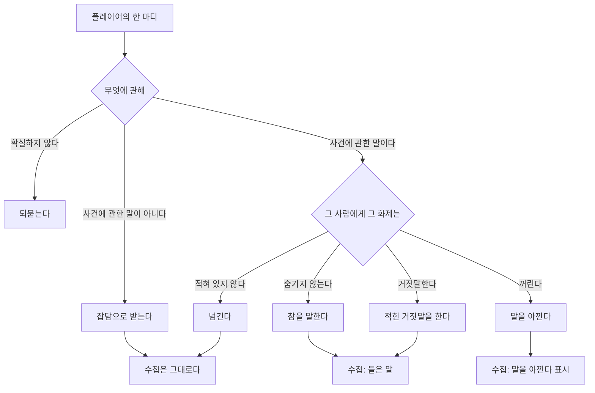

# 대화

**사람이 묻는 말에 어떻게 대답하는가**와 **장면을 어떻게 들려주는가**를 정한다. 막힘을 뚫는 법과 태도가 바뀌는 때는 [05-blocks.md](05-blocks.md)가 정한다. 낱말은 [03-notebook.md](03-notebook.md)를 따른다.

## 한눈에

- 사람이 사건에 관해 하는 말은 **모두 이야기에 적혀 있다.**
- 규칙이 **무엇을 말할지** 고르고, AI가 **어떻게 말할지** 정한다.
- AI는 그 말이 참인지 거짓말인지 **모른다.** 할 말과 태도를 받을 뿐이다.
- 이야기에 없는 것을 물으면 그 사람답게 **넘긴다.** 수첩에는 아무것도 적히지 않는다.

## 1. 대답에 쓰는 것

이야기가 사람마다 적어 둔 것 가운데 대답에 쓰는 것이다. 적는 것 전부는 08에 있다.

| 무엇 | 뜻 |
|---|---|
| **신상** | 이름, 하는 일, 성격, 말버릇. AI가 목소리를 만드는 재료다 |
| **인상** | 공통 인상(4절) 말고 이 사람만 받는 인상. 이름과 알아볼 설명. 없어도 된다 |
| **가까운 사람** | 소문을 전해 듣는 사이(4절). 없어도 된다 |
| **화제** | 이 사람이 사건에 관해 말할 수 있는 것 하나하나. 화제마다 아래 셋이 있다 |
| └ **이름** | 내용을 담지 않은 짧은 이름. "아버지의 저녁". 알아듣기, 표시, 운 떼기에 쓴다 |
| └ **자세** | 숨기지 않는다, 꺼린다, 거짓말한다 중 하나 |
| └ **할 말** | 이 사람이 하는 말. 거짓말하는 화제에는 거짓말과 깨진 뒤의 말을, 꺼리는 화제에는 풀린 뒤의 말을 적는다 |

- **관계, 행적, 가진 것, 그날의 일**은 신상이 아니라 화제다. 화제로 적히지 않았으면 넘긴다.
- **사람은 틀리게 알지 않는다.** 참을 말하거나, 알면서 거짓말한다.
- **화제는 통째로 답한다.** 어느 쪽으로 물어도 그 화제의 할 말을 모두 한다. 수첩에도 한 줄로 통째로 적힌다. 그래서 할 말은 한두 문장으로 쓴다(08).

## 2. 네 가지 대답

사건에 관한 말이 아니면 **잡담**이다. 인사, 날씨, 그 사람의 신상, 부탁, 넋두리, 농담. 수첩은 그대로다. 사건에 관한 말이면 넷 중 하나가 된다.

| 그 사람에게 그 화제는 | 대답 | 수첩 |
|---|---|---|
| **숨기지 않는다** | 적힌 말을 한다 | 들은 말 |
| **꺼린다** | 말해 주지 않는다. 내용은 한 마디도 하지 않는다 | 그 사람 줄에 "말을 아낀다" 표시 |
| **거짓말한다** | 적힌 거짓말을 한다 | 들은 말. 여느 들은 말과 똑같이 보인다 |
| **적혀 있지 않다** | 그 사람답게 넘긴다 | 적히지 않는다 |

> **당신**: 저녁에 사당 쪽은 어땠습니까?
> **토빈**: 일곱 시쯤 앞을 지나갔는데요, 안이 깜깜했어요. *(숨기지 않는다 → 들은 말)*
>
> **당신**: 숲길에서 다른 것은 못 봤습니까?
> **토빈**: ……몰라요. 말 안 할래요. *(꺼린다 → "말을 아낀다" 표시)*
>
> **당신**: 징수관은 왼손잡이였습니까?
> **토빈**: 그런 건 몰라요. *(적혀 있지 않다 → 수첩은 그대로)*

넘김:

- **넘기는 말은 맞다 아니다를 말하지 않는다.** "글쎄요", "제가 아는 바가 없습니다."
- **이야기 어디에도 없는 것을 물어도 넘긴다.**
- **아직 나오지 않은 화제**(08)도 적혀 있지 않은 것으로 다룬다. 물으면 넘기고, 그 막힘은 내밀기와 견주지 않는다. 알아듣기, 운 떼기, "모두 들었다"에서도 뺀다.

거짓말과 꺼림:

- **거짓말은 화제 하나를 통째로 덮는다.** 그 화제를 어떻게 돌려 물어도, 우겨도, 같은 거짓말이 나온다.
- **깨지거나 풀리면** 그 화제는 "숨기지 않는다"가 되고, 이야기에 적힌 다음 말을 한다(05).

## 3. 규칙이 고르고, AI가 말한다

AI는 두 번 일한다. 먼저 문장을 **알아듣는다.** 화제인지 잡담인지, 옮기려는 말인지를 가린다. 이때는 그 사람의 화제 이름과 묻는 말(08)만 받고, 자세와 할 말은 받지 않는다. 그다음 **말한다.** 말할 때 받는 것은 아래 아홉뿐이다. 앞의 넷이 이번에 할 말을 정하고, 뒤의 다섯은 이 사람이 플레이어와 지금까지 겪은 것이다. 뒤의 다섯은 모두 플레이어가 한 말과 일, 이미 화면에 나온 것에서 나오므로 숨긴 것이 새지 않는다.

| 받는 것 | 내용 |
|---|---|
| **신상** | 그 사람의 성격과 말버릇 |
| **할 말** | 이번에 말할 내용. 꺼림이면 "이 화제는 말해 주지 않는다", 넘김이면 "답할 것이 없다", 운 떼기면 그 화제의 이름, 다 말했으면 "더 말할 것이 없다", 되묻기면 헷갈리는 화제들의 이름, 잡담이면 없다 |
| **태도** | 지금 플레이어를 어떻게 대하는가 |
| **플레이어의 한 마디** | 방금 쓴 문장. 받아치는 데만 쓴다 |
| **곳과 때** | 지금 있는 곳과 시각 |
| **앞서 나눈 말** | 이 사람과 최근에 주고받은 세 번. 플레이어의 말과 이 사람의 대답 |
| **이미 한 말** | 수첩에 적힌 이 사람의 들은 말. 다시 물으면 "아까 말했잖소"처럼 받는다 |
| **지켜본 일** | 이 사람이 곁에서 본 플레이어의 최근 행동. 둘러보기, 잠긴 것 열기, 남에게 내밀거나 따지기 |
| **인상** | 플레이어가 이 사람에게 남긴 인상과 그 뜻. 한 번인지 여러 번인지 |
| **소문** | 플레이어가 남에게 남긴 인상 가운데 이 사람이 보거나 전해 들은 것 |

AI가 **받지 않는 것**:

- 그 말이 참인지 거짓말인지.
- 이 사람이 숨기는 내용.
- 다른 사람이 아는 것, 진실.

그래서 AI는 **새게 할 것을 갖고 있지 않다.** 거짓말할 때 저도 모르게 티를 내는 일도 없다.

AI가 **지어내는 것**은 목소리다.

- 말투, 감정, 몸짓, 인사와 맞장구.
- 플레이어가 방금 한 말에 대한 반응. 다정하게 물으면 그 대답 안에서 누그러지고, 몰아세우면 굳는다. 태도는 바뀌지 않는다(4절).
- 앞서 나눈 말과 지켜본 일에 대한 반응. 같은 말을 되풀이하지 않고, 방금 플레이어가 한 일을 보고 한마디 얹는다. 그래서 세계가 플레이어에게 반응한다고 느낀다.
- 신상에 기댄 잡담. 신상에 적힌 것만 쓴다. 적히지 않은 사실을 물으면 지어내지 않고 넘긴다.
- 할 말의 **표현.** 적힌 문장을 그대로 읽지 않고 그 사람의 말로 바꾼다. 뜻은 바꾸지 않는다.

**대답은 한두 문장이다.** 길게 말하지 않는다.

## 4. 태도, 인상, 소문

- 태도는 그 사람이 플레이어를 **얼마나 믿고, 얼마나 두려워하는가**다. 말투와 몸짓을 정한다. 믿으면 말이 풀리고, 두려우면 굳는다.
- 말투와 몸짓은 **그 말이 참인지 거짓인지에 따라 달라지지 않는다.**
- **태도는 규칙과 쌓인 인상이 바꾼다**(05 4절). 한 마디로는 바뀌지 않는다.

**인상**은 플레이어가 그 사람에게 남긴 것이다. 사람마다 쌓이고, 판이 끝날 때까지 남는다.

| 인상 | 무엇이 남기는가 | 태도 |
|---|---|---|
| **다정** | 다정하게 부르거나 안부를 묻는 말 | 믿음 쪽 |
| **위로** | 그 사람의 처지를 헤아려 달래는 말 | 믿음 쪽 |
| **칭찬** | 그 사람을 추켜세우는 말 | 믿음 쪽 |
| **선물** | 무언가를 건네거나 대접하겠다는 말 | 믿음 쪽 |
| **무례** | 깔보거나 부리거나 욕하는 말. 그 사람이 주인인 잠긴 것을 그 앞에서 몰래 하거나 힘으로 열려 한 일 | 믿음을 잃는 쪽 |
| **의심** | 그 사람을 범인이나 거짓말쟁이로 모는 말 | 믿음을 잃는 쪽 |
| **위협** | 해치겠다고 으르는 말. 그 앞에서 남을 몰아세운 일 | 두려움 쪽 |
| **들킴** | 그 앞에서 남을 속이려다 들킨 일 | 믿음을 잃는 쪽 |

- **말이 남기는 인상은 AI가 알아듣는다.** 상대에게 한 말 하나가 남기는 인상은 많아야 하나다. 남기지 않는 말이 더 많다. 들킴은 말로 남지 않는다.
- **일이 남기는 인상은 규칙이 붙인다.** 그 자리에 있던, 그 일을 당하지 않은 사람에게 붙는다. 당한 사람의 태도는 이미 주사위가 바꾼다(05 4절).
- 이야기는 사람마다 **자기만의 인상**을 한둘 더할 수 있다. *최두식 — 옛정: 함께 지낸 세월이나 옛 경기를 꺼낸다.* 자기만의 인상은 태도를 움직이지 않고, 입을 여는 데(05 1절)와 말투에만 쓴다.
- **같은 쪽 인상이 두 번 쌓일 때마다 태도가 한 단계 움직인다.** 다정 한 번과 칭찬 한 번이면 믿음이 오른다.

**소문**은 플레이어가 남에게 남긴 인상을 다른 사람이 아는 것이다. 퍼지는 것은 인상뿐이다. 단서나 사실은 퍼지지 않는다.

- 그 자리에 있던 사람은 **바로** 안다(본 소문).
- 이야기가 **가까운 사람**으로 적은 사이는 두 칸 뒤에 안다(들은 소문). 한쪽에만 적어도 서로 가깝다. 떠난 사람에게는 가지 않는다.
- 먼 사이에는 퍼지지 않는다.
- **소문은 말투에만 닿는다.** 태도를 움직이지도, 입을 열지도 않는다. 결과를 바꾸는 것은 직접 겪은 인상뿐이다.

## 5. 대화가 끊기지 않게

**화제는 목록으로 보여 주지 않는다.** 플레이어는 수첩의 줄과 그 사람의 말에서 물을 것을 떠올린다. 그래서 막히지 않게 아래처럼 한다.

| 상황 | 하는 일 |
|---|---|
| **어느 화제인지 확실하지 않다** | 넘기지 않고 되묻는다. "어느 것을 말씀하시는지요?" 이야기에 있는 것을 못 알아듣고 넘기는 일은 없어야 한다 |
| **한 마디에 화제가 둘이다** | 하나씩 차례로, 각각 짧게 답한다 |
| **이미 들은 화제를 다시 묻는다** | 같은 내용을 짧게 다시 말한다. 새 줄은 생기지 않는다 |
| **같은 화제를 세 번째 묻는다** | 같은 대답을 짧게 한 뒤 다른 화제의 운을 뗀다 |
| **한 사람에게 넘김이 연달아 세 번이다** | 다른 화제의 운을 뗀다. 통하지 않은 내밀기도 넘김으로 센다 |
| **꺼리지 않는 화제를 모두 들었다** | 그 사람이 그렇게 말한다. "말씀드릴 수 있는 것은 다 말씀드렸습니다." |

- **운을 뗀다**: 아직 듣지 못한, 꺼리지 않는 화제(숨기지 않거나 거짓말하는 화제) 하나의 이름만 꺼낸다. 되물을 때 꺼내는 이름에서도 아직 나오지 않은 화제는 뺀다. 내용은 말하지 않으므로 수첩은 그대로다. 그런 화제가 없으면 다 말했다고 한다.
- **다 말했다고 할 때**, 아직 묻지 않은 꺼리는 화제가 있으면 그 이름으로 "말을 아낀다" 표시가 붙는다. 꺼리는 화제가 나중에 나오면 그 사람과 다음에 말할 때 붙는다.

## 6. 장면

사람의 대답이 아니라 곳과 일을 들려줄 때다. 곳에 들어설 때, 둘러볼 때, 잠긴 것이 열릴 때, 조짐과 번진 일, 결말이 그렇다. AI가 받는 것은 아래뿐이다.

| 받는 것 | 내용 |
|---|---|
| **곳의 모습** | 이야기가 적은 그곳의 모습(08) |
| **이번에 적히는 줄** | 새 본 것, 물건. 없으면 없다 |
| **일어난 일** | 조짐, 번진 일, 결말의 대목, 진실 풀이 중 이번 것 |
| **이곳의 사람** | 지금 그곳에 있는 사람의 이름 |

- 아직 나오지 않은 볼 것, 보여 주는 사실, 진실은 받지 않는다. 진실 풀이는 결말에서만 받는다.
- 지어내는 것은 날씨, 소리, 빛 같은 **분위기**뿐이다. 받은 줄에 없는 물건이나 흔적은 그리지 않는다.
- 장면도 짧다. 두세 문장을 넘지 않는다. 이번에 적힌 것이 많으면 눈에 띄는 두세 가지만, 적힌 자리와 모양 그대로 그린다.
- **들어설 때는 모습과 사람만 그린다.** 놓인 것은 둘러볼 때 그린다(03).
- **당신이 없는 곳에서 번진 일은 소식으로 전한다.** "그 사이"로 시작하고, 보고 듣는 것처럼 쓰지 않는다(06).
- **다시 들어선 곳은 이름과 그곳의 사람만 말한다.** 모습은 처음 들어설 때 한 번만 그린다. 그사이 바뀐 것이 있으면 그것만 덧붙인다.
- 그곳에 있는 사람은 장면 끝에 이름으로 알린다.

판을 이끄는 진행자(DM)의 말은 장면과 같은 모양으로 이어지지만, 언제 무엇을 말하는지는 07 2절이 정한다.
