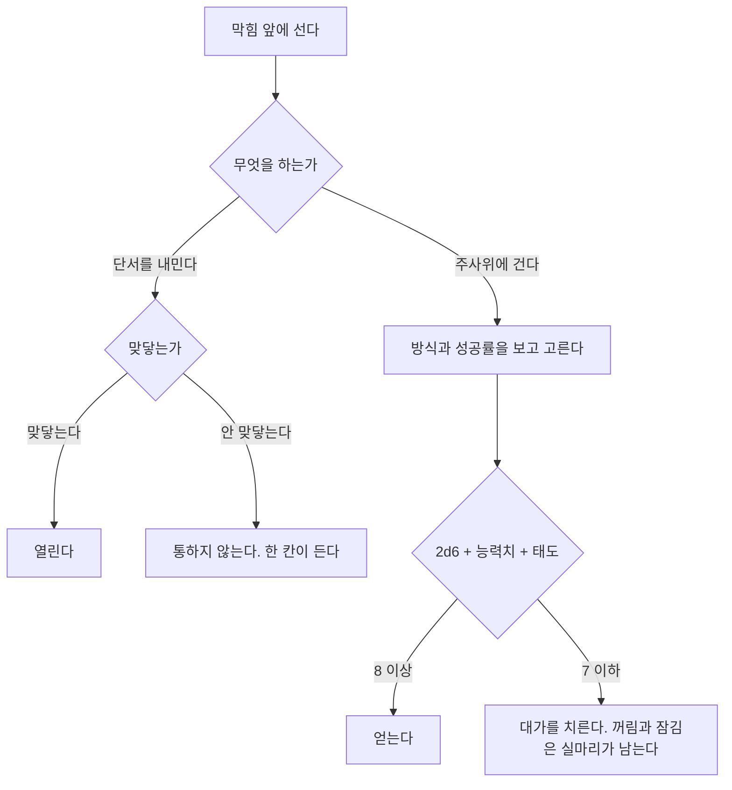

# 막힘과 주사위

**막힌 곳을 어떻게 뚫는가**를 정한다. 단서를 내미는 확실한 길과, 주사위에 거는 위험한 길이다. 낱말은 [03-notebook.md](03-notebook.md)를 따른다.

## 한눈에

- 막힘은 셋이다: **거짓말, 꺼림, 잠김.**
- **맞는 단서를 내밀면 반드시 열린다.** 태도가 어떻든, 그 전에 주사위에 실패했든.
- 단서가 없으면 **주사위에 걸 수 있다.** 성공하면 지금 얻고, 실패하면 대가를 치른다.
- **거짓말은 단서로만 깨진다.** 주사위로 얻는 것은 그 말이 거짓말인지 아닌지뿐이다. 이야기가 허락한 거짓말만 인상으로도 깨진다(1절).
- 이야기가 허락한 꺼림과 거짓말은 **맞는 인상이 쌓이면 대화로 열린다.**
- 무엇을 하든 **수첩의 줄은 잃지 않는다.**

## 1. 이야기가 막힘마다 적는 것

| 막힘 | 이야기가 적는 것 | 맞는 단서 |
|---|---|---|
| **거짓말** | **깨는 사실.** 하나나 여럿이다 | 그 사실을, 여럿이면 그 가운데 하나를 보여 주는 단서 |
| **꺼림** | 그 사람이 **바라는 것.** 사실 하나나 성질 하나다 | 그 사실을 보여 주는 단서, 또는 그 성질을 가진 물건 |
| **잠김** | **약점.** 성질 하나다. 주인이 있으면 그 사람도 적는다 | 그 성질을 가진 물건 |

이야기는 "이 단서를 여기에 쓴다"라고 적지 않는다. 사실과 성질만 적는다. 그래서 맞닿는 것이면 **무엇이든** 통한다.

꺼림과 거짓말에는 **풀리는 인상**을 적을 수 있다. 인상 하나와 몇 번 쌓여야 하는지다(없으면 한 번). 그 인상이 그만큼 쌓인 뒤 그 화제를 물으면, 맞는 단서를 내민 것과 똑같이 열린다. 깨진 거짓말은 줄이 그어지고 깨진 뒤의 말이 적힌다. 인상은 같은 마디에서 먼저 붙으므로, 위로하며 물으면 그 자리에서 풀릴 수 있다.

> 윤소라의 꺼림 — 풀리는 인상: *위로.* "많이 놀랐지? 네 탓 아니야. 혹시 본 거 있어?"

풀리는 인상은 덤의 길이다. 그 막힘에도 단서나 주사위의 길이 따로 있어야 한다(5절). 진실의 "누가"를 덮는 거짓말에는 두지 않기를 권한다. 추리 없이 구슬려서 범인이 밝혀진다.

> 브람의 거짓말 "여관에 오지도 않았다" — 깨는 사실: *징수관은 해 질 녘 여관에 들렀다.*
> 시신의 허리띠에 달린 여관 나무패(본 것)도, 넬의 "해 질 녘에 징수관이 여관 쪽으로 가는 걸 봤다"(들은 말)도 그 사실을 보여 준다. 어느 쪽을 내밀어도 깨진다.
>
> 장부 궤짝 — 약점: *가늘고 단단하다.* 여관의 쇠꼬챙이도, 넬의 약초 칼도 연다.

## 2. 내밀기

- 플레이어가 **단서 하나**를 가리켜 **사람이나 잠긴 것**에 내민다. 저절로 내밀어지지 않는다. 잠긴 것에는 물건만 내민다. 맞닿는 것이 성질뿐이기 때문이다.
- 내민 단서는 그 대상의 **막힘 전부**와 견준다. 어느 화제를 말하며 내밀었는지는 따지지 않는다. 아직 나오지 않은 화제의 막힘은 뺀다(04).
- 맞닿는 막힘이 있으면 **모두 열린다.** 주사위는 굴리지 않는다. 여럿이 함께 열리면 그 사람은 깨진 거짓말의 다음 말을 먼저, 풀린 꺼림의 말을 이어서 각각 짧게 한다.
- 맞닿는 것이 없으면 **통하지 않는다.** 대가는 시간뿐이다. 그래서 무엇을 내밀지 고르는 것이 추리다.
- **통하지 않은 내밀기는 기억된다.** 그 대상에 새 막힘이 생기기 전까지, 같은 단서를 다시 내미는 단추에 "아까 통하지 않았다"가 붙는다(07). 같은 헛걸음을 모르고 되풀이하지 않게 한다.

가려 둘 것:

- **통하지 않으면** 사람은 넘기고(04의 넘김), 잠긴 것은 열리지 않는 장면만 나온다(04의 장면). 왜 통하지 않았는지는 알려 주지 않는다.
- **내밀기가 든 한 마디는 내밀기로만 다룬다.** 말투는 상관없고, 곁들인 물음에는 따로 답하지 않는다.
- **자기 말은 자기 꺼림에 통하지 않는다.** 자기 거짓말에는 통한다. 제 말끼리 어긋나는 것이기 때문이다.
- **거짓말인 들은 말은 통하지 않는다.** 깨지기 전이든 줄이 그어진 뒤든 같다. 보여 주는 사실이 없기 때문이다. 통하지 않는 것을 보고 거짓말을 짐작하는 것은 플레이어의 추리다.
- **아직 듣지 못한 거짓말도 깨진다.** 그때는 깨진 뒤의 말만 수첩에 적힌다.

열리면 이렇게 된다.

| 막힘 | 열리면 | 수첩 |
|---|---|---|
| **거짓말** | 깨진다. 그 사람이 적힌 다음 말을 한다 | 거짓말에 줄이 그어지고, 새 들은 말이 적힌다 |
| **꺼림** | 풀린다. 그 사람이 그 화제를 말한다 | "말을 아낀다" 표시가 떨어지고, 들은 말이 적힌다 |
| **잠김** | 열린다 | 그 줄에 "열었다" 표시가 붙는다. 안에 든 것이 적힌다(03) |

## 3. 주사위에 걸기

단서 없이 캐내려 할 때다. **수첩에 보이는 것 하나**를 겨눠야 한다. 겨눈 것이 없으면 굴리지 않고, 그냥 묻거나 살펴본 것이 된다.

| 겨누는 것 | 방식 | 성공하면 | 실패하면 |
|---|---|---|---|
| **들은 말 하나** | 달래기, 몰아세우기, 속이기 | 그 말에 표시가 붙는다. 거짓말이면 "숨기는 것이 있다", 참이면 "거짓이 아니다" | 남는 것이 없고, 그 말에는 다시 걸 수 없다 |
| **"말을 아낀다" 표시 하나** | 달래기, 몰아세우기, 속이기 | 꺼림이 풀린다 | 실마리가 붙는다 |
| **잠긴 것 하나** | 몰래 하기, 힘쓰기 | 열린다 | 실마리가 붙는다 |

- **굴리기 전에 보여 준다.** 주사위 창이 무엇을 겨눠 어떤 방식으로 거는지, 넘어야 할 수(8 이상)와 더해지는 값, 성공률과 드는 칸을 보여 준다(07). 모르고 주사위에 걸리는 일은 없다.
- **주사위는 플레이어가 굴린다.** 창에서 굴리기를 눌러야 굴린다. 굴리기 전에 닫으면 아무 일도 없고 칸도 들지 않는다. 눈은 그때 판의 씨앗과 턴으로 정해지므로, 닫았다 다시 열어도 다시 굴리는 것이 아니다.
- **주사위는 두 곳에서 시작한다.** 수첩의 줄 단추, 그리고 글로 쓴 행동(04 2절)이다. 행동은 방식 하나로 읽힌다. 때리기, 붙잡기, 으르기는 몰아세우기, 다독이기와 사정하기는 달래기, 꾀기와 떠보기는 속이기, 비틀기와 부수기는 힘쓰기, 따기는 몰래 하기다. 행동이 확실하면 그 사람이 반응한 뒤 **주사위 창이 바로 뜬다.** 행동인지 확실하지 않은 글에는 창 대신 단추 하나가 뜬다(04 2절). 어느 쪽이든 글을 보내기만 해서는 굴리지 않는다.
- **사람에게 하는 행동은 하나를 겨눈다.** 그 사람이 말을 아끼는 화제가 있으면 그것을, 없으면 그 사람이 가장 나중에 한 들은 말 가운데 겨눌 수 있는 것을 겨눈다. 그래서 행동 하나에 주사위도 하나다. 다른 말을 겨누려면 수첩의 그 줄에서 건다. 잠긴 것에 하는 행동은 그 잠긴 것을 겨눈다.
- **들은 말은 참이든 거짓말이든 똑같이 굴린다.** 굴릴 수 있다는 것만으로는 아무것도 알 수 없다.
- **표시가 붙어도 거짓말은 깨지지 않는다.** 수첩이 표시로 거짓말을 알려 주는 것은 이때뿐이다. 깨려면 단서가 있어야 한다.
- 줄 그어진 말, 이미 표시가 붙은 말, 걸었다가 실패한 말은 겨눌 수 없다.
- **결과는 대답에서 보인다.** 성공과 실패가 같은 대답으로 끝나지 않는다.

| 겨눈 것 | 성공하면 그 사람은 | 실패하면 그 사람은 |
|---|---|---|
| **들은 말(거짓말)** | 그 방식에 밀려 그 말을 다시 하지만, 말끝이 흔들리고 숨기는 티가 난다 | 넘어가지 않고 맞서거나 화를 낸다. 새로 털어놓는 것이 없다 |
| **들은 말(참)** | 그 방식에 밀려 그 말이 참이라고 흔들림 없이 다시 말한다 | 같다 |
| **꺼림** | 밀려서 숨기던 것을 털어놓는다 | 넘어가지 않고 다시 말을 아낀다 |
| **잠김** | 열린다 | 열리지 않는 장면만 나온다 |

성공한 들은 말에서 숨기는 티와 흔들림 없음이 갈리는 것은 붙는 표시와 같은 것을 알리는 것이다. 실패한 대답은 참이든 거짓말이든 같아서 아무것도 새지 않는다.

### 방식과 능력치

| 방식 | 뜻 | 능력치 |
|---|---|---|
| **달래기** | 마음을 얻어 듣는다 | 매력 |
| **몰아세우기** | 겁을 줘서 듣는다 | 완력 |
| **속이기** | 거짓으로 떠본다 | 재치 |
| **몰래 하기** | 뒤진다, 딴다 | 솜씨 |
| **힘쓰기** | 부순다, 억지로 연다 | 완력 |

플레이어는 시작할 때 능력치 넷 중 하나에 +2, 다른 하나에 +1을 준다. 나머지는 0이다.

### 굴림

**2d6 + 능력치 + 태도**(잠긴 것이면 단단함)가 **8 이상**이면 성공이다.

| 더하는 것 | 값 |
|---|---|
| 능력치 | 0, +1, +2 |
| 태도 | 달래기에는 그 사람의 믿음을, 몰아세우기에는 두려움을 더한다. 속이기에는 없다 |
| 단단함 | 이야기가 단단하다고 적은 잠긴 것은 -1 |

8 이상은 더하는 것이 0이면 열에 넷쯤, +2면 열에 일곱쯤 나온다. 숫자는 가정이다. 첫 이야기를 돌려 보고 고친다.

### 실패

- **대가를 치른다.** 태도가 나빠진다(아래 표). 시간은 성공해도 실패해도 든다.
- **실패한 방식은 같은 것에 다시 쓰지 못한다.** 달래다 실패한 꺼림은 다시 달랠 수 없다. 다른 방식이나 단서가 남는다. **들은 말은 어느 방식으로든 다시 걸 수 없다.** 그 말에서 더 캐낼 기회를 잃는 것이 실패의 값이다. 거짓말이면 단서로 깨는 길은 남는다.
- **실마리**는 이야기가 꺼림과 잠김마다 적어 둔 한 마디다. 무엇을 내밀면 되는지를 가리킨다. 표시로 붙는다.
- **들은 말에는 실마리가 없다.** 붙으면 거짓말인 것이 드러나기 때문이다. 참에도 거짓말에도 똑같이 남는 것이 없다.

> 토빈 — *숲길에서 본 것은 말을 아낀다* · *실마리: "아저씨가 목을 조른 게 아니라면 말할게요."*

## 4. 태도

태도는 두 값이다. **믿음**과 **두려움.** 각각 낮다(-1), 보통(0), 높다(+1)이다. 처음 값은 이야기가 사람마다 적는다. 바뀌는 때는 아래뿐이다.

| 한 일 | 믿음 | 두려움 |
|---|---|---|
| 달래기 성공 | 한 단계 오른다 | |
| 달래기 실패 | 한 단계 내린다 | |
| 몰아세우기 성공 | 한 단계 내린다 | 한 단계 오른다 |
| 몰아세우기 실패 | | 한 단계 내린다 |
| 속이기 성공 | | |
| 속이기 실패 | 한 단계 내린다 | |
| 바라는 것을 단서로 채웠다 | 한 단계 오른다 | |
| 거짓말을 깼다 | | 한 단계 오른다 |
| 그 사람이 주인인 잠긴 것에 몰래 하기, 힘쓰기 실패 | 한 단계 내린다 | |
| 믿음 쪽 인상이 두 번 쌓일 때마다(04 4절) | 한 단계 오른다 | |
| 믿음을 잃는 쪽 인상이 두 번 쌓일 때마다 | 한 단계 내린다 | |
| 위협이 두 번 쌓일 때마다 | | 한 단계 오른다 |
| 풀리는 인상으로 꺼림이 열렸다 | 한 단계 오른다 | |
| 풀리는 인상으로 거짓말이 깨졌다 | | 한 단계 오른다 |

- 끝 단계에서는 더 가지 않는다.
- 태도가 닿는 곳은 둘뿐이다. **주사위**와 **말투**(04).
- 인상에서 오는 움직임은 쌓인 수가 둘, 넷, 여섯이 될 때마다다. 같은 쪽 인상을 셈에 더한다.

## 5. 길은 둘 이상이다

이야기는 모든 막힘에 길을 둘 이상 둔다.

| 막힘 | 길 |
|---|---|
| **거짓말** | 깨는 사실을 보여 주는 단서가 **서로 다른 곳에 둘 이상** 있다 |
| **꺼림** | 맞는 단서 하나 이상, 그리고 주사위 |
| **잠김** | 맞는 물건 하나 이상, 그리고 주사위 |

주사위에 모두 실패해도 단서의 길은 남는다. 주사위와 태도로는 닫히지 않는다. 번진 일이 벌어진 뒤에는 길이 하나만 남아도 된다(06, 08).
