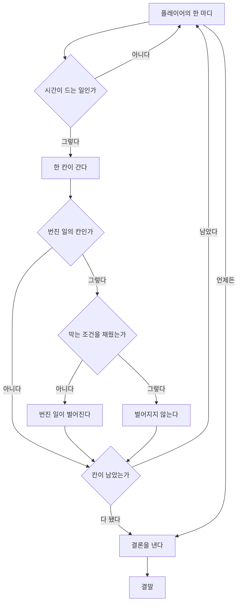

# 시간과 결론

**시간이 어떻게 가고, 한 판이 어떻게 끝나는가**를 정한다. 낱말은 [03-notebook.md](03-notebook.md)를, 막힘과 주사위는 [05-blocks.md](05-blocks.md)를 따른다.

## 한눈에

- 시간은 **칸**으로 센다. 한 판은 보통 **24칸**이고, 이야기가 정한다.
- 묻고 살펴보는 것은 **공짜**다. 옮기고, 걸고, 틀리게 내밀면 **한 칸**이 간다.
- 정해진 칸이 되면 **번진 일**이 벌어진다. 플레이어가 미리 막을 수 있는 것도 있다.
- 결론은 **언제든** 낼 수 있고, **한 번만** 낸다. 시간이 다 되면 내야 한다.
- 결론은 쓰지 않고 **수첩에서 고른다.** 규칙이 진실과 견준다.

## 1. 시간

| 하는 일 | 드는 칸 |
|---|---|
| 묻기, 잡담, 둘러보기 | 0 |
| 맞는 단서 내밀기 | 0 |
| 수첩 보기, 결론 내기 | 0 |
| **다른 곳으로 옮기기** | 1 |
| **틀린 단서 내밀기** | 1 |
| **주사위에 걸기** (성공해도 실패해도) | 1 |

- 옮기는 칸은 **가는 길에 든다.** 그 칸의 번진 일은 닿기 전에 벌어지고, 닿은 곳에서는 남은 것만 본다.
- 남은 칸은 **언제나 보인다.**
- **칸이 다 되면** 그 한 마디의 결과까지만 듣고 결론을 낸다. 묻기와 살펴보기도 더 하지 못한다. 수첩은 볼 수 있다.
- 이야기는 칸에 시각을 붙일 수 있다. "한 칸은 이십 분, 새벽 네 시 종이 울리면 끝난다."
- 숫자는 가정이다. 첫 이야기를 돌려 보고 고친다.

## 2. 번진 일

이야기는 번진 일마다 넷을 적는다. 결말에 붙을 대목은 4절에 있다.

| 적는 것 | 뜻 |
|---|---|
| **때** | 몇 번째 칸에 벌어지는가 |
| **일** | 무슨 일이 벌어지는가. 사람이 떠나거나 다른 곳으로 옮기고, 아직 보지 않은 것이 없어진다. 여럿이 함께 일어나도 된다 |
| **막는 조건** | 그때까지 정해진 막힘 하나를 열었으면 벌어지지 않는다. 적지 않아도 된다 |
| **조짐** | 벌어지기 전에 오는 기척. 어디서든 보이거나 들리는 일로 쓴다 |

> 16칸째 — 토빈이 아버지를 따라 산 너머 숯가마로 떠난다. 막는 조건: *토빈의 꺼림을 풀었다.*

- **조짐이 먼저 온다.** 벌어지기 세 칸 전에 장면으로 알려 준다. "숲 쪽에서 토빈을 부르는 아버지의 목소리가 들린다." 플레이어가 어디에 있든 나온다. 때가 너무 일러 세 칸 전이 없으면 조짐 없이 벌어진다. 조짐은 단서가 아니고 수첩에 적히지 않는다.
- **막은 일은 조짐이 오지 않는다.** 막는 조건을 이미 채웠으면 조용히 지나간다. 막았다는 것은 결말에서 알려 준다.
- **그 칸에 한 일을 먼저 셈한다.** 그 일로 막는 조건을 채웠으면 벌어지지 않는다.
- **벌어지면 바로 알려 준다.** 플레이어가 있는 곳의 일이면 눈앞의 일로, 다른 곳의 일이면 진행자가 소식처럼 들려준다. 떠난 사람의 줄에는 "떠났다" 표시가 붙는다.

### 번진 일이 건드리지 못하는 것

- **수첩의 줄.** 이미 적힌 것은 그대로다. 손에 넣은 물건과 이미 본 것은 없어지지 않는다. 떠난 사람에게서 들은 말도 내밀 수 있다.
- **단서의 길.** 남은 막힘에는 맞는 단서를 얻을 길이 여전히 있다. 떠난 사람의 거짓말과 꺼림은 막힘에서 빠진다. 잠긴 것은 주인이 떠나도 남는다.
- **결론에 닿는 길.** 어떻게와 왜를 보여 주는 단서는 칸이 남아 있는 한 어느 번진 일 뒤에도 얻을 수 있다.

이야기가 이렇게 쓰여야 한다. 기계가 검사한다(08).

## 3. 결론

수첩을 펴고 세 물음에 답한다.

| 물음 | 고르는 것 | 맞는 때 |
|---|---|---|
| **누가** | 수첩의 사람 하나 | 진실의 그 사람이다 |
| **어떻게** | 수첩의 단서 하나 | 그 단서가 보여 주는 사실이 진실의 "어떻게"다 |
| **왜** | 수첩의 단서 하나 | 그 단서가 보여 주는 사실이 진실의 "왜"다 |

- **비워 둘 수 있다.** 누가를 모르면 비우는 것이 엉뚱한 사람을 짚는 것보다 낫다.
- **같은 사실을 보여 주는 단서면 어느 것이든 맞다.**
- 거짓말인 들은 말도 고를 수는 있다. 줄이 그어졌든 아니든 언제나 틀리다.
- **한 번만 낸다.** 내기 전에 확인한다. 내면 한 판이 끝난다.

## 4. 결말

결말은 두 가지가 정한다. 밝힌 정도와 번진 일이다.

**밝힌 정도**

| 결말 | 때 |
|---|---|
| **다 밝혔다** | 셋을 모두 맞혔다 |
| **누구인지는 밝혔다** | 누가를 맞혔고, 어떻게와 왜 중 하나라도 맞히지 못했다 |
| **엉뚱한 사람을 짚었다** | 누가를 틀렸다 |
| **밝히지 못했다** | 누가를 비웠다 |

**증명과 짐작**: 누가를 맞혔을 때, 수첩에 범인을 가리키는 사실이 있고 범인 말고 의심받는 사람이 모두 지워졌으면 **증명**, 아니면 **짐작**이다. 지워지는 것은 그 사람을 벗기는 사실이 수첩에 있거나, 수첩의 사실이 알리는 범인의 성질과 그 사람의 성질이 어긋날 때다(08 1절). 밝힌 정도는 그대로이고 결말 화면과 결말 글이 둘을 가른다. 의심받는 사람을 적지 않은 이야기는 가르지 않는다.

**번진 일**: 벌어진 것과 막은 것마다 한 대목씩 붙는다. 막는 조건을 채웠으면 때가 오기 전에 결론을 내도 막은 대목이 붙는다. 막지도 않았고 때도 오지 않은 번진 일에는 대목이 붙지 않는다.

- 결말의 내용은 **이야기가 적는다.** AI는 그것을 장면으로 들려준다.
- 결말 뒤에 **진실을 모두 보여 준다.** 세 물음 가운데 무엇을 맞히고 틀렸는지와 놓친 막힘을 함께 보여 준다. 만나 본 막힘을 앞에, 만나지도 못한 막힘을 뒤에 둔다(07 4절).
- 어떤 결말도 "실패"라고 부르지 않는다. 한 판은 언제나 이야기로 끝난다.
