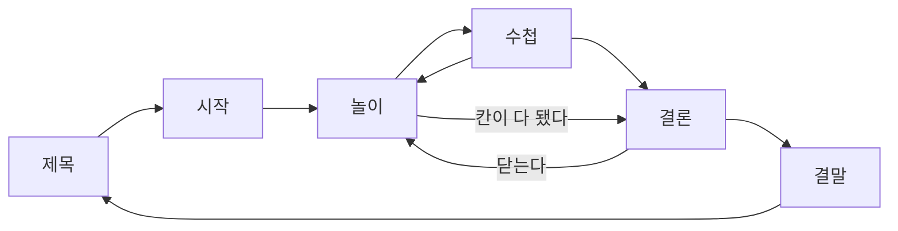

# 화면

**플레이어가 무엇을 보고 무엇을 누르는가**를 정한다. 색, 글꼴, 간격은 만들 때 정한다. 낱말은 [03-notebook.md](03-notebook.md)를 따른다.

## 한눈에

- 휴대전화 세로 화면 하나다. 넓은 화면에서도 같은 폭으로 보인다.
- 장면과 인물의 그림은 없다. 그림은 단추 같은 화면 요소에만 쓴다. 놀이는 **글과 수첩**으로 한다.
- 놀이 화면은 넷으로 나뉜다: **위 띠, 대화, 이곳의 사람, 입력.** 스크롤되는 것은 대화뿐이다.
- 수첩은 **언제든 한 번에** 열린다.
- **글로 써야 하는 것은 묻기뿐이다.** 나머지는 줄이나 곳 이름을 눌러, 지금 할 수 있는 일만 고른다.
- 칸이 드는 일은 **누르기 전에 드는 것을 보여 준다.** 결론은 두 단추로 한 번 더 고른다.
- **설명하는 글을 두지 않는다.** 조작 안내, 규칙 설명, 빈 화면 안내, 결과 해설은 없다. 알아야 할 것은 숫자와 모양, 장면 글과 사람의 대답으로 보인다.
- **DM이 판을 이끈다.** TRPG의 진행자처럼 가끔 세계의 기척을 보여 준다. 사람의 몸짓, 다른 곳에서 들려오는 소리, 다가오는 기한 같은 것이다. 무엇을 하라고는 말하지 않는다(2절). 화면을 설명하는 글과는 다르다.



## 1. 화면들

| 화면 | 보이는 것 | 할 수 있는 일 |
|---|---|---|
| **제목** | 이야기 목록. 하던 판이 있으면 이어 하기 | 이야기를 고른다 |
| **시작** | 능력치 넷, 한 줄에 하나씩 아이콘과 이름, 숫자 양옆의 삼각형. 도입 글은 없다. 사건은 첫 사람에게 듣는다(04 5절) | 삼각형으로 숫자를 올리고 내려 +2 하나와 +1 하나를 정하고 시작한다. 다른 능력치가 가진 숫자로 올리면 그쪽은 0이 된다 |
| **놀이** | 위 띠, 대화, 이곳의 사람, 입력 | 묻고, 옮기고, 줄을 눌러 내밀거나 건다 |
| **수첩** | 줄과 표시 | 읽는다. 줄을 눌러 그 자리에서 펼친다. 결론으로 간다 |
| **결론** | 누가, 어떻게, 왜 세 물음 | 수첩에서 골라 채우고 낸다 |
| **결말** | 지목한 사람의 대꾸, 결말 글과 진실 풀이, 맞힌 물음 | 제목으로 돌아간다 |

## 2. 놀이 화면

```
┌──────────────────────────────────┐
│ ⌖ 촌장 집         ◷ 밤 11시 20분  ⧗ 14  ▣3 ⚙ │  위 띠
├──────────────────────────────────┤
│                                  │
│  대화                              │
│                                  │
├──────────────────────────────────┤
│ [관찰] [이동] (고드릭) (마렌)             │  이곳의 사람
│ [ 마렌에게 묻기…               ] [보내기] │  입력
└──────────────────────────────────┘
```

| 자리 | 보이는 것 |
|---|---|
| **위 띠** | 다섯 묶음(곳, 시각, 남은 칸, 수첩, 설정)을 같은 크기로 등간격에 둔다. 묶음마다 아이콘에 글자를 붙인다. 핀 아이콘과 지금 있는 곳의 이름. 시계 아이콘과 이야기 속 시각, 모래시계 아이콘과 남은 칸의 수(가운데 점 없이). 시각, 남은 칸, 수첩의 수는 같은 크기다. 수첩 단추: 수첩 아이콘 옆에 새로 적혀 아직 열어 보지 않은 줄의 수를 아이콘만 한 크기로 나란히 보인다(다섯 묶음을 모두 센다). 설정 아이콘 단추: 지금은 "새 게임" 하나로, 제목으로 돌아가며 하던 판은 "이어 하기"로 남는다 |
| **대화** | 장면 글과 DM의 말, 플레이어의 말, 사람의 대답, 수첩 알림, 조짐과 번진 일. 사람의 대답과 DM의 도움에 나온, 그 사람의 아직 듣지 못한 화제 이름은 밑줄 친 파란 글씨다(04 5절). 누르면 작은 카드가 떠서 화제 이름, 꺼낸 사람, 아직 못 들었다는 것을 보인다. 카드에서 물을 수는 없고, 밖을 누르거나 Escape로 닫는다 |
| **이곳** | 맨 앞의 "관찰"(눈 아이콘)과 "이동"(핀 아이콘), 그리고 지금 이곳에 있는 사람. "관찰"을 누르면 곳을 둘러보고, "이동"을 누르면 갈 곳 시트가 열린다. 사람을 누르면 그 사람과 말하고, 다시 누르면 풀린다 |
| **입력** | 글 쓰는 곳과 보내기 단추뿐이다 |

- **늘 보이는 것은 이 넷뿐이다.** 나머지는 아래에서 올라오는 시트로 연다. 수첩, 갈 곳, 결론이다. 줄에서 할 일은 수첩 안에서 그 줄을 펼쳐 연다. 시트는 모두 같은 방식으로 움직인다. 짧은 것(갈 곳, 결론)은 담은 만큼만 올라오고, 긴 것(수첩, 결론의 고르기)은 화면의 절반까지 올라와 대화가 함께 보이며 위로 당기면 화면을 채운다. 어느 것이든 아래로 내리면 닫힌다. 대화 속 알림으로 한 줄을 열면 처음부터 화면을 채운다. 창의 제목 앞에는 아이콘을 두지 않는다.
- **글로 써야 하는 것은 묻기뿐이다.** 옮기기, 내밀기, 주사위는 누르기로 한다. 화제는 목록으로 보여 주지 않으므로(04) 묻기만은 글로 한다.
- **말하는 상대가 늘 보인다.** 고른 사람이 진하게 보인다. 이곳에 사람이 하나뿐이면 저절로 골라진다. 아무도 고르지 않고 쓰면 곳을 둘러보는 것이다. 상대가 있어도 "주위를 둘러본다"처럼 쓰면 둘러본다(03). "구둣주걱을 자세히 본다"처럼 이곳의 것이나 수첩의 물건을 살피면, 둘러보며 그것을 눈여겨본다.
- **되묻기는 그 사람의 대답으로 나온다.** 수첩 알림도 없고 칸도 가지 않는다. 플레이어는 다음 문장으로 답한다.
- **대답은 쓰이는 대로 보인다.** 대답이 끝날 때까지 입력과 누르기가 잠긴다.
- **기다리는 동안 점 세 개가 차례로 깜박인다.** 보낸 말은 곧바로 대화에 보이고, 그 아래에 점이 뜬다. 사람의 대답을 기다릴 때는 그 사람의 이름 아래에 뜬다.
- **말한 사람이 구별된다.** 장면 글과 DM의 말, 플레이어, 사람의 대답은 모양이 다르다. 사람마다 제 색이 있어, 대답의 이름과 옆줄, 이곳의 사람 단추의 점이 그 색이다. 색은 수첩의 사람 차례로 정해져 한 판 내내 같다.

### 수첩 알림

수첩이 바뀌면 대화 속에 짧은 한 줄이 끼어든다. AI의 글과 모양이 다르다. 한 번의 일로 바뀐 것은 한 줄에 묶는다.

> *수첩 · 브람의 말 적음*
> *수첩 · 목 자국, 검푸른 입술, 여관 나무패 적음*
> *수첩 · 브람의 말 — 앞의 말에 줄을 긋고 새 말 적음*
> *수첩 · 토빈 — 숲길에서 본 것은 말을 아낀다*

- **내용을 되풀이하지 않는다.** 들은 말은 바로 위의 대답이 이미 말했으므로 누구의 말인지만 적는다. 본 것과 물건은 짧은 이름만 적는다.

- **알림은 누를 수 있다.** 누르면 수첩이 그 줄의 묶음으로 열리고, 그 줄이 펼쳐져 보인다. 방금 들은 말을 한 번 눌러 바로 내밀 수 있다.
- 여러 줄이 묶인 알림을 누르면 수첩의 그 묶음이 열린다.
- 알림이 없으면 수첩은 그대로다. 플레이어는 이것으로 **단서와 잡담을 가른다.**

### DM

DM은 일반적인 TRPG에서 탁자 앞에 앉아 판을 이끄는 진행자다. 장면을 들려주고, 사람의 몸짓을 그리고, 가끔 **기척**을 하나 보여 준다. 가 보지 않은 곳에서 들려오는 소리나 냄새, 다가오는 기한 같은 것이다. 기척을 보고 무엇을 할지는 플레이어가 고른다. DM의 말은 따로 표시하지 않고 장면 글과 같은 모양으로 이어진다. 글은 AI가 진행자의 목소리로 쓴다(engine/01 3절).

**목소리.** 시각, 소리, 냄새, 맛, 촉감 가운데 하나를 살려 감각적으로 그리고, 건조한 블랙 조크 한마디를 곁들일 수 있다. 사건은 진지하지만 풀어 가는 말은 비꼬듯 가볍다. 크게 웃기지는 않는다. 이야기의 분위기가 그 온도를 정한다(08 2절).

**몸짓.** 사람은 대사만 하고, 몸짓은 DM이 그린다. 신호가 있을 때만, 그 사람의 대사 다음에 나온다. 몸짓이 곧 힌트이므로 아무 때나 그리지 않는다.

| 신호 | 그리는 것 |
|---|---|
| 굴림으로 그 사람의 말에 숨기는 것이 있다고 드러났다 | 말끝이나 눈길에 스친 틈. 거짓말의 틈은 굴림에 이겨야만 보인다 |
| 그 사람이 화제를 얼버무렸다 | 꺼리는 기색. 두려우면 겁먹은 기색, 믿지 않으면 경계하는 기색 |
| 쌓인 인상으로 곁의 사람의 태도가 바뀌었다 | 마음이 기운 몸짓. 믿음이 오르면 누그러진 기색, 내리면 굳은 기색, 두려움이 오르면 움츠린 기색 |

**기척과 도움.** 신호가 아닌 말은 드물게 한다.

| 언제 | 하는 말 |
|---|---|
| 아직 말을 나눠 보지 않은 사람 곁에 왔다 | 그 사람이 하던 일을 멈추고 당신을 알아채는 몸짓 |
| 아직 둘러보지 않은 곳에 왔다 | 이곳의 모습 가운데 하나에 눈길이 머문다. 무엇이 있는지는 말하지 않는다. 곳마다 한 번 |
| 누가, 어떻게, 왜를 보여 주는 줄이 다 모였고 네 마디째 새 줄이 없다 | 조각이 다 모인 듯하니 이제 한번 따져 볼 때라는 기분. 한 번 |
| 여덟 마디째부터 새 줄이 없다 | 도움 하나. 아래 차례로, 하지 않은 것 가운데 할 수 있는 첫 것. 셋을 다 하면 더 짚지 않는다 |
| 네 마디째 새 줄이 없다 | 둘러보지 않은 이곳에 머무는 눈길, 아직 기척을 보이지 않은 안 가 본 곳에서 닿는 소리나 빛이나 냄새, 없으면 곁의 사람이 더 말할 듯 머뭇거리는 몸짓, 없으면 다가오는 기한과 지금까지 듣고 본 것을 되짚는 당신. 새 줄이 없는 동안 네 마디마다 |
| 칸이 다 됐다 | 기한이 닥쳤다는 것과 결론을 들려 달라는 말 |

도움은 막힌 플레이어에게 할 거리를 하나 쥐여 준다. 답은 주지 않는다.

1. 곁의 사람이 아직 꺼내지 않은 화제 하나를 입에 올리고 싶어 하는 눈치다. 그 화제의 이름을 말한다(밑줄이 쳐진다).
2. 당신이 수첩의 줄 하나를 문득 떠올린다. 아직 열리지 않은 막힘 하나에 맞는 줄이다. 어디에 내밀지는 말하지 않는다.
3. 당신이 아직 안 가 본 곳 하나를 이름으로 떠올린다.

- **드물게 말한다.** 신호와 끝 말고는, DM이 말한 뒤 네 마디가 지나야 다시 말한다. 그 사이의 일은 넘어간다. 한 마디에 많아야 한 줄이다.
- **기척은 보이고 권하지 않는다.** "경기장으로 가 보십시오"가 아니라 "경기장 쪽 문틈으로 하얀 조명이 번뜩입니다"다. 권하면 답을 일러 주는 것이 되고, 플레이어가 고르는 재미가 없어진다. 기척은 그곳의 모습에 나온 것에서 나는 소리, 빛, 냄새와 사람의 몸짓뿐이다. 없는 사람이나 물건, 벌어진 일을 지어내지 않고, 사람의 대사도 지어내지 않는다. 직접 청하는 것은 결론뿐이다.
- **몸짓은 신상, 성격, 하는 일, 태도에서만 짐작한다.** 사건의 진실, 단서, 누가 거짓말하는지는 말하지 않는다. 무엇을 내밀면 되는지도 말하지 않는다. 화제의 이름은 도움 1에서만 말한다.
- **화면을 설명하지 않는다.** 무엇을 누르는지, 화면의 어디에 있는지는 말하지 않는다.
- 흔한 TRPG 진행의 원칙을 따랐다. 단서가 플레이어를 찾아오게 하고([The Alexandrian, Three Clue Rule](https://thealexandrian.net/wordpress/1118/roleplaying-games/three-clue-rule)), 위협의 조짐을 보여 주되 어떻게 할지는 플레이어에게 맡기며([Apocalypse World의 GM 행동, "show signs of an approaching threat"](https://magpiegames.com/blogs/news/picking-the-right-gm-move-in-pbta-part-one)), 막혔을 때는 가장 덜 끼어드는 것부터 쓰고 답은 주지 않는다([Gnome Stew, Getting Out of the Ditch](https://gnomestew.com/getting-out-of-the-ditch/)). 막힌 플레이어에게는 답보다 할 거리가 필요하다([The Alexandrian](https://thealexandrian.net/?p=44589)).
- 읽기, 상대 고르기, 결론은 DM을 부르지 않는다. 여럿이 겹치면 표의 위에 있는 것 하나만 말한다. 칸이 다 된 때가 가장 앞선다.

### 옮기기

- 위 띠의 곳 이름을 누르면 **갈 수 있는 곳**이 나온다. 안 가 본 곳은 표시가 붙고, 고르면 한 칸이 간다는 것을 함께 보여 준다.
- 옮기면 대화에 "── 숲길 · 1턴 ──" 같은 가름줄이 생긴다. 단추로 옮기면 플레이어의 말은 남기지 않는다.
- 문장으로 써도 된다. "여관으로 간다."
- 이어지지 않은 곳을 고르거나 쓰면 가장 짧은 길로 간다. 지나는 곳마다 한 칸이 들고, 갈 곳 목록에도 그 칸 수가 적힌다.

### 줄에서 하는 일

수첩의 줄을 누르면 따로 창을 띄우지 않고 그 자리에서 펼쳐진다. 다시 누르면 접히고, 한 번에 한 줄만 펼쳐진다. 접힌 줄은 소개나 모습을 두 줄까지 보이고, 펼치면 다 보인다. 펼친 줄 아래에는 이어진 줄이 모인다(03 1절). 모인 줄을 누르면 그 줄의 묶음으로 가서 그 줄이 펼쳐진다. 펼쳐도 더 보일 것이 없는 줄은 눌리지 않는다. 단추로는 그 줄로 **지금 할 수 있는 일만** 나온다. 내밀기, 주사위, 잠긴 것 열기가 모두 여기서 시작한다.

| 누른 줄 | 나오는 단추 |
|---|---|
| **물건, 본 것, 들은 말** | "○○에게 내민다". 말하는 상대가 있을 때 |
| **들은 말** | 위에 더해 달랜다, 몰아세운다, 속인다 |
| **"말을 아낀다" 표시** | 달랜다, 몰아세운다, 속인다 |
| **잠긴 것** | 가진 물건마다 "○○를 쓴다". 몰래 연다, 힘으로 연다 |
| **물건** | 위에 더해, 이곳에 잠긴 것이 있으면 "○○에 쓴다" |

### 행동 뒤에 뜨는 단추

글로 쓴 행동이나 행동 같은 글(04 2절)에 걸 수 있는 주사위가 있으면, 대답 뒤에 그 단추가 입력 위에 한 줄로 뜬다. 단추의 글은 줄 단추와 같다("최두식을 몰아세운다 · 58% · 1턴"). 많으면 가로로 밀어 본다. 누르면 그 주사위를 굴리고, 다른 무엇을 하면 사라진다. 설명 글은 붙이지 않는다.

> **토빈 — 숲길에서 본 것은 말을 아낀다**
> [ 달랜다 · 72% · 1턴 ] [ 몰아세운다 · 42% · 1턴 ] [ 속인다 · 58% · 1턴 ]
>
> **장부 궤짝이 잠겨 있었다**
> [ 쇠꼬챙이를 쓴다 · 틀리면 1턴 ] [ 몰래 연다 · 28% · 1턴 ] [ 힘으로 연다 · 28% · 1턴 ]

*(보기의 성공률은 매력 +2, 재치 +1, 믿음과 두려움이 보통일 때다. 장부 궤짝은 단단하다.)*

- **할 수 없는 것은 나오지 않는다.** 그 사람이나 잠긴 것이 이곳에 없으면 그 줄에서 할 일이 없다. 이미 실패한 방식, 겨눌 수 없는 줄(05)의 주사위 단추도 나오지 않는다.
- **들은 말에는 참이든 거짓말이든 똑같은 단추가 나온다.** 단추로는 아무것도 알 수 없다(05).
- **단추에 드는 것을 적는다.** 내밀기와 쓰기는 "틀리면 1턴"이다. 이미 통하지 않았고 그 뒤로 상대에게 새로 걸린 것이 없으면 "아까 통하지 않았다 · 1턴"으로 적는다. 막지는 않는다. 주사위는 성공률과 "1턴". 들은 말에 거는 주사위는 누구에게 하는지 적는다("강태오를 몰아세운다").
- **주사위 단추가 확인을 겸한다.** 무엇을 겨눠 어떤 방식으로, 몇 %로, 몇 칸을 쓰는지 단추에 다 적혀 있으므로 누르면 바로 굴린다(05).
- **무엇을 내밀지는 언제나 플레이어가 고른다.** AI가 문장에서 짐작하지 않는다.
- **입력칸에 쓴 말이 있으면 함께 보낸다.** "아버님을 위해서라도 말씀해 주십시오" 같은 말을 붙일 수 있다. 비어도 된다. 붙인 말은 대답의 말투에만 닿고 결과는 바꾸지 않는다.
- 사람의 것을 누르면 그 사람이 말하는 상대로 골라진다.
- 굴리면 방식과 **주사위 눈, 더한 값, 합**, 넘어야 할 수를 한 줄로 보여 주고("몰아세운다 · 5 + 1 + 2 = 8 · 8 이상"), 이어서 대답이나 장면, 수첩 알림이 온다. 잃은 태도는 다음 단추의 성공률로 드러난다.

### 시간

- 칸이 가면 숫자가 바뀌는 것이 눈에 띈다.
- **조짐**과 **번진 일**은 대화 속에 따로 구분된 줄로 나온다.
- 마지막 세 칸에는 띠의 모양이 달라진다.
- 칸이 다 되면 입력이 닫히고 결론 화면으로 간다.

## 3. 수첩

화면을 덮는 한 장이다. 닫으면 하던 대화로 돌아온다.

| 묶음 | 보이는 것 |
|---|---|
| **곳** | 이름. 안 가 봄 표시 |
| **사람** | 이름. 말을 아끼는 화제, 실마리, 떠났다 표시 |
| **물건** | 이름 |
| **본 것** | 문장. 열었다, 실마리 표시 |
| **들은 말** | 사람별로 묶인다. 줄 그어진 말, 숨기는 것이 있다, 거짓이 아니다 표시 |

- 묶음은 다섯 개의 탭이다. 한 번에 한 묶음만 보인다.
- 줄을 누르면 그 자리에서 펼쳐져 그 줄에서 할 일이 보인다(2절).
- 새로 생기거나 바뀐 줄은 한 번 볼 때까지 표시된다.
- **화제의 목록은 없다.** 태도의 값도 어디에도 없고, 주사위 단추의 성공률로만 드러난다.
- 수첩 아래에 **결론 내기** 단추가 있다.

## 4. 결론과 결말

### 결론

| 물음 | 누르면 |
|---|---|
| **누가** | 수첩의 사람 목록 |
| **어떻게** | 수첩의 단서 목록 |
| **왜** | 수첩의 단서 목록 |

- 물음은 처음에 모두 비어 있다. 비운 채로 낼 수 있고, 비운 물음은 결말에서 "비운 것"이 된다(06).
- 단추는 [ 낸다 ] 하나다. 결론 창을 닫으면 놀이로 돌아간다. 칸은 가지 않는다.
- 칸이 다 됐을 때는 결론 창이 닫히지 않는다. [ 수첩 ]으로 수첩을 읽는 것만 된다.

### 결말

차례로 보여 준다.

1. **대꾸.** 누가로 지목한 사람이 당신의 지목에 대사로 반응한다. 맞혔으면 궁지에 몰린 사람의 반응, 틀렸으면 억울해서 펄쩍 뛰는 반응이다. 사건의 내용은 말하지 않는다. 누가를 비웠으면 없다. 사람의 이름 아래에 보인다.
2. **결말 글.** DM의 목소리로, 밝힌 정도에 따른 대목, 번진 일의 대목, 이어서 사건의 전말(진실 풀이).
3. **맞힌 물음.** 세 물음 가운데 맞힌 것, 틀린 것, 비운 것.
4. **놓친 것.** 깨지 못한 거짓말, 풀지 못한 꺼림, 열지 못한 잠김. 만나 본 것을 먼저 두고, 듣거나 찾지도 못한 것은 뒤에 "듣지 못함", "꺼내지 못함", "찾지 못함"을 붙여 둔다.
5. 제목으로.

## 5. 끊겼을 때

- **판은 저절로 저장된다.** 닫았다 열면 하던 자리에서 이어진다.
- 대답이 오지 않으면 입력을 잠근 채 **같은 말을 다시 보내는 단추**만 내준다. 같은 한 마디가 두 번 처리되지 않는다.
- 저장된 판을 불러오지 못해도 지우지 않는다. 다시 시도할 수 있게 둔다.

## 6. 지키는 것

- **가장 작은 화면(폭 320)에서 모든 것이 들어간다.** 바깥 스크롤이 없다.
- 창은 Esc로 닫히고, 닫히면 열었던 단추로 초점이 돌아간다.
- 장면 글과 단추는 "당신"과 합니다체다. 사람의 대답은 그 사람의 말버릇을 따른다(04). 수첩의 줄은 이야기에 적힌 대로 해라체다(08).
- 화면에 나오는 낱말은 03의 낱말과 같다.
