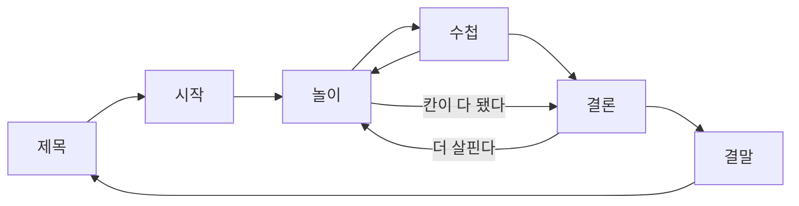

# 화면

**플레이어가 무엇을 보고 무엇을 누르는가**를 정한다. 색, 글꼴, 간격은 만들 때 정한다. 낱말은 [03-notebook.md](03-notebook.md)를 따른다.

## 한눈에

- 휴대전화 세로 화면 하나다. 넓은 화면에서도 같은 폭으로 보인다.
- 장면과 인물의 그림은 없다. 그림은 단추 같은 화면 요소에만 쓴다. 놀이는 **글과 수첩**으로 한다.
- 놀이 화면은 넷으로 나뉜다: **위 띠, 대화, 이곳의 사람, 입력.** 스크롤되는 것은 대화뿐이다.
- 수첩은 **언제든 한 번에** 열린다.
- **글로 써야 하는 것은 묻기뿐이다.** 나머지는 줄이나 곳 이름을 눌러, 지금 할 수 있는 일만 고른다.
- 칸이 드는 일은 **누르기 전에 드는 것을 보여 준다.** 결론은 두 단추로 한 번 더 고른다.
- **설명하는 글을 두지 않는다.** 조작 안내, 규칙 설명, 빈 화면 안내, 결과 해설은 없다. 알아야 할 것은 숫자와 모양, 장면 글과 사람의 대답으로 보인다.
- **DM이 판을 이끈다.** TRPG의 진행자처럼 가끔 인물의 인상을 말하고, 막막할 때 다음에 해 볼 만한 일을 권한다(2절). 화면을 설명하는 글과는 다르다.



## 1. 화면들

| 화면 | 보이는 것 | 할 수 있는 일 |
|---|---|---|
| **제목** | 이야기 목록. 하던 판이 있으면 이어 하기 | 이야기를 고른다 |
| **시작** | 도입 글. 능력치 넷 | +2와 +1을 줄 능력치를 고르고 시작한다 |
| **놀이** | 위 띠, 대화, 이곳의 사람, 입력 | 묻고, 옮기고, 줄을 눌러 내밀거나 건다 |
| **수첩** | 줄과 표시 | 읽는다. 줄을 눌러 그 줄에서 할 일을 연다. 결론으로 간다 |
| **결론** | 누가, 어떻게, 왜 세 물음 | 수첩에서 골라 채우고 낸다 |
| **결말** | 결말 글, 맞힌 물음, 진실 풀이 | 제목으로 돌아간다 |

## 2. 놀이 화면

```
┌──────────────────────────────────┐
│ 촌장 집 ▾          밤 11시 20분 · 14턴  수첩 3 │  위 띠
├──────────────────────────────────┤
│                                  │
│  대화                              │
│                                  │
├──────────────────────────────────┤
│ (고드릭) (마렌)                       │  이곳의 사람
│ [ 마렌에게 묻기…               ] [보내기] │  입력
└──────────────────────────────────┘
```

| 자리 | 보이는 것 |
|---|---|
| **위 띠** | 지금 있는 곳의 이름. 이야기 속 시각과 남은 칸. 수첩 단추와, 새로 적혀 아직 열어 보지 않은 줄의 수. 곳, 사람, 들은 말도 센다 |
| **대화** | 장면 글과 DM의 말, 플레이어의 말, 사람의 대답, 수첩 알림, 조짐과 번진 일 |
| **이곳의 사람** | 지금 이곳에 있는 사람. 한 사람을 누르면 그 사람과 말한다. 다시 누르면 풀린다 |
| **입력** | 글 쓰는 곳과 보내기 단추뿐이다 |

- **늘 보이는 것은 이 넷뿐이다.** 나머지는 아래에서 올라오는 시트로 연다. 수첩, 갈 곳, 줄에서 할 일, 결론이다.
- **글로 써야 하는 것은 묻기뿐이다.** 옮기기, 내밀기, 주사위는 누르기로 한다. 화제는 목록으로 보여 주지 않으므로(04) 묻기만은 글로 한다.
- **말하는 상대가 늘 보인다.** 고른 사람이 진하게 보인다. 이곳에 사람이 하나뿐이면 저절로 골라진다. 아무도 고르지 않으면 곳을 다시 살펴보는 것이다. 장면만 다시 듣고 새 줄은 없다(03).
- **되묻기는 그 사람의 대답으로 나온다.** 수첩 알림도 없고 칸도 가지 않는다. 플레이어는 다음 문장으로 답한다.
- **대답은 쓰이는 대로 보인다.** 대답이 끝날 때까지 입력과 누르기가 잠긴다.
- **기다리는 동안 점 세 개가 차례로 깜박인다.** 보낸 말은 곧바로 대화에 보이고, 그 아래에 점이 뜬다. 사람의 대답을 기다릴 때는 그 사람의 이름 아래에 뜬다.
- **말한 사람이 구별된다.** 장면 글과 DM의 말, 플레이어, 사람의 대답은 모양이 다르다. 사람마다 제 색이 있어, 대답의 이름과 옆줄, 이곳의 사람 단추의 점이 그 색이다. 색은 수첩의 사람 차례로 정해져 한 판 내내 같다.

### 수첩 알림

수첩이 바뀌면 대화 속에 짧은 한 줄이 끼어든다. AI의 글과 모양이 다르다. 한 번의 일로 바뀐 것은 한 줄에 묶는다.

> *수첩 · 브람의 말 적음*
> *수첩 · 목 자국, 검푸른 입술, 여관 나무패 적음*
> *수첩 · 브람의 말 — 앞의 말에 줄을 긋고 새 말 적음*
> *수첩 · 토빈 — 숲길에서 본 것은 말을 아낀다*

- **내용을 되풀이하지 않는다.** 들은 말은 바로 위의 대답이 이미 말했으므로 누구의 말인지만 적는다. 본 것과 물건은 짧은 이름만 적는다.

- **알림은 누를 수 있다.** 누르면 그 줄에서 할 일이 열린다. 방금 들은 말을 수첩을 열지 않고 바로 내밀 수 있다.
- 여러 줄이 묶인 알림을 누르면 수첩의 그 묶음이 열린다.
- 알림이 없으면 수첩은 그대로다. 플레이어는 이것으로 **단서와 잡담을 가른다.**

### DM

DM은 일반적인 TRPG에서 탁자 앞에 앉아 판을 이끄는 진행자다. 장면을 그리지 않고, 가끔 인물에 대한 인상을 한마디 하거나 막막한 플레이어에게 다음에 해 볼 만한 일을 권한다. 잔소리가 되지 않게 **드물게** 말한다. 장면을 들려주는 것도 진행자이므로, DM의 말은 따로 표시하지 않고 장면 글과 같은 모양으로 이어진다. 글은 AI가 진행자의 목소리로 쓴다(engine/01 3절).

| 언제 | 하는 말 |
|---|---|
| 판을 시작했다 | 곁의 사람의 첫인상, 그 사람에게 물어보라는 권유. 아무도 없으면 다른 곳으로 가 보라는 권유 |
| 아직 말을 나눠 보지 않은 사람 곁에 왔다 | 그 사람의 첫인상, 말을 걸어 보라는 권유 |
| 처음으로 누가 입을 다물었다 | 그 사람의 속내를 짐작하는 한마디, 마음을 움직일 무언가가 필요해 보인다는 말 |
| 네 마디째 새 줄이 없다 | 안 가 본 곳, 없으면 곁의 사람에게 다시 묻거나 내밀어 보라는 권유, 없으면 수첩을 다시 보라는 권유. 새 줄이 없는 동안 네 마디마다 |
| 칸이 다 됐다 | 결론을 들려 달라는 말 |

- **드물게 말한다.** 시작과 끝 말고는, DM이 말한 뒤 네 마디가 지나야 다시 말한다. 그 사이의 일은 넘어간다. 한 마디에 많아야 한 줄이다.
- **인상은 신상과 태도에서만 짐작한다.** 사건의 진실, 단서, 누가 거짓말하는지는 말하지 않는다. 무엇을 내밀면 되는지, 화제의 이름도 말하지 않는다.
- **화면을 설명하지 않는다.** 무엇을 누르는지, 화면의 어디에 있는지는 말하지 않는다. 묻기, 옮기기, 내밀기처럼 이야기 속에서 할 일로 권한다.
- 읽기, 상대 고르기, 결론은 DM을 부르지 않는다. 여럿이 겹치면 표의 위에 있는 것 하나만 말한다. 칸이 다 된 때가 가장 앞선다.

### 옮기기

- 위 띠의 곳 이름을 누르면 **갈 수 있는 곳**이 나온다. 안 가 본 곳은 표시가 붙고, 고르면 한 칸이 간다는 것을 함께 보여 준다.
- 옮기면 대화에 "── 숲길 · 1턴 ──" 같은 가름줄이 생긴다. 단추로 옮기면 플레이어의 말은 남기지 않는다.
- 문장으로 써도 된다. "여관으로 간다."
- 이어지지 않은 곳을 고르거나 쓰면 가장 짧은 길로 간다. 지나는 곳마다 한 칸이 들고, 갈 곳 목록에도 그 칸 수가 적힌다.

### 줄에서 하는 일

수첩의 줄이나 대화 속 수첩 알림을 누르면, 그 줄로 **지금 할 수 있는 일만** 단추로 나온다. 내밀기, 주사위, 잠긴 것 열기가 모두 여기서 시작한다.

| 누른 줄 | 나오는 단추 |
|---|---|
| **물건, 본 것, 들은 말** | "○○에게 내민다". 말하는 상대가 있을 때 |
| **들은 말** | 위에 더해 달랜다, 몰아세운다, 속인다 |
| **"말을 아낀다" 표시** | 달랜다, 몰아세운다, 속인다 |
| **잠긴 것** | 가진 물건마다 "○○를 쓴다". 몰래 연다, 힘으로 연다 |
| **물건** | 위에 더해, 이곳에 잠긴 것이 있으면 "○○에 쓴다" |

> **토빈 — 숲길에서 본 것은 말을 아낀다**
> [ 달랜다 · 72% · 1칸 ] [ 몰아세운다 · 42% · 1칸 ] [ 속인다 · 58% · 1칸 ]
>
> **장부 궤짝이 잠겨 있었다**
> [ 쇠꼬챙이를 쓴다 · 틀리면 1칸 ] [ 몰래 연다 · 28% · 1칸 ] [ 힘으로 연다 · 28% · 1칸 ]

*(보기의 성공률은 매력 +2, 재치 +1, 믿음과 두려움이 보통일 때다. 장부 궤짝은 단단하다.)*

- **할 수 없는 것은 나오지 않는다.** 그 사람이나 잠긴 것이 이곳에 없으면 그 줄에서 할 일이 없다. 이미 실패한 방식, 겨눌 수 없는 줄(05)의 주사위 단추도 나오지 않는다.
- **들은 말에는 참이든 거짓말이든 똑같은 단추가 나온다.** 단추로는 아무것도 알 수 없다(05).
- **단추에 드는 것을 적는다.** 내밀기와 쓰기는 "틀리면 1턴", 주사위는 성공률과 "1턴". 들은 말에 거는 주사위는 누구에게 하는지 적는다("강태오를 몰아세운다").
- **주사위 단추가 확인을 겸한다.** 무엇을 겨눠 어떤 방식으로, 몇 %로, 몇 칸을 쓰는지 단추에 다 적혀 있으므로 누르면 바로 굴린다(05).
- **무엇을 내밀지는 언제나 플레이어가 고른다.** AI가 문장에서 짐작하지 않는다.
- **입력칸에 쓴 말이 있으면 함께 보낸다.** "아버님을 위해서라도 말씀해 주십시오" 같은 말을 붙일 수 있다. 비어도 된다. 붙인 말은 대답의 말투에만 닿고 결과는 바꾸지 않는다.
- 사람의 것을 누르면 그 사람이 말하는 상대로 골라진다.
- 굴리면 방식과 **주사위 눈, 더한 값, 합**을 한 줄로 보여 주고("몰아세운다 · 5 + 1 + 2 = 8"), 이어서 대답이나 장면, 수첩 알림이 온다. 잃은 태도는 다음 단추의 성공률로 드러난다.

### 시간

- 칸이 가면 숫자가 바뀌는 것이 눈에 띈다.
- **조짐**과 **번진 일**은 대화 속에 따로 구분된 줄로 나온다.
- 마지막 세 칸에는 띠의 모양이 달라진다.
- 칸이 다 되면 입력이 닫히고 결론 화면으로 간다.

## 3. 수첩

화면을 덮는 한 장이다. 닫으면 하던 대화로 돌아온다.

| 묶음 | 보이는 것 |
|---|---|
| **곳** | 이름. 안 가 봄 표시 |
| **사람** | 이름. 말을 아끼는 화제, 실마리, 떠났다 표시 |
| **물건** | 이름 |
| **본 것** | 문장. 열었다, 실마리 표시 |
| **들은 말** | 사람별로 묶인다. 줄 그어진 말, 숨기는 것이 있다, 거짓이 아니다 표시 |

- 묶음은 다섯 개의 탭이다. 한 번에 한 묶음만 보인다.
- 줄을 누르면 그 줄에서 할 일이 열린다(2절).
- 새로 생기거나 바뀐 줄은 한 번 볼 때까지 표시된다.
- **화제의 목록은 없다.** 태도의 숫자도 수첩에 없다. 주사위 카드에서만 보인다.
- 수첩 아래에 **결론 내기** 단추가 있다.

## 4. 결론과 결말

### 결론

| 물음 | 누르면 |
|---|---|
| **누가** | 수첩의 사람 목록 |
| **어떻게** | 수첩의 단서 목록 |
| **왜** | 수첩의 단서 목록 |

- 물음은 처음에 모두 비어 있다. 비운 채로 낼 수 있고, 비운 물음은 결말에서 "비운 것"이 된다(06).
- 내기 전에 [ 낸다 ] [ 더 살핀다 ] 두 단추로 한 번 더 고른다.
- 더 살피면 놀이로 돌아간다. 칸은 가지 않는다.
- 칸이 다 됐을 때는 "더 살핀다"가 없다. 수첩을 읽는 것만 된다.

### 결말

차례로 보여 준다.

1. **결말 글.** 밝힌 정도에 따른 대목, 이어서 번진 일의 대목.
2. **맞힌 물음.** 세 물음 가운데 맞힌 것, 틀린 것, 비운 것.
3. **진실 풀이.** 사건의 전말.
4. **놓친 것.** 깨지 못한 거짓말, 풀지 못한 꺼림, 열지 못한 잠김.
5. 제목으로.

## 5. 끊겼을 때

- **판은 저절로 저장된다.** 닫았다 열면 하던 자리에서 이어진다.
- 대답이 오지 않으면 입력을 잠근 채 **같은 말을 다시 보내는 단추**만 내준다. 같은 한 마디가 두 번 처리되지 않는다.
- 저장된 판을 불러오지 못해도 지우지 않는다. 다시 시도할 수 있게 둔다.

## 6. 지키는 것

- **가장 작은 화면(폭 320)에서 모든 것이 들어간다.** 바깥 스크롤이 없다.
- 창은 Esc로 닫히고, 닫히면 열었던 단추로 초점이 돌아간다.
- 장면 글과 단추는 "당신"과 합니다체다. 사람의 대답은 그 사람의 말버릇을 따른다(04). 수첩의 줄은 이야기에 적힌 대로 해라체다(08).
- 화면에 나오는 낱말은 03의 낱말과 같다.
