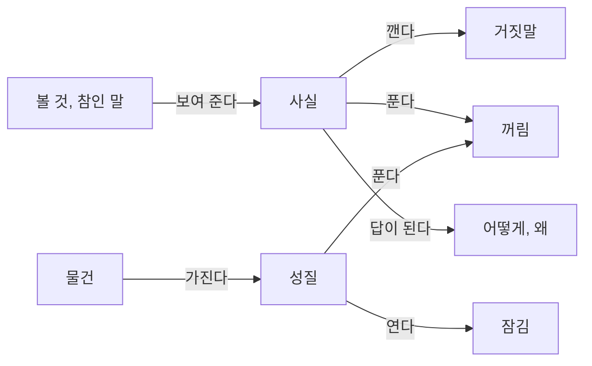

# 이야기 쓰는 법

**이야기 하나에 무엇을 적는가**와 **그것을 어떻게 검사하는가**를 정한다. 파일의 정확한 문법은 만들 때 정한다. 줄거리로 새 이야기를 짜는 순서는 [09-authoring.md](09-authoring.md)가 정한다. 낱말은 [03-notebook.md](03-notebook.md)를 따른다.

## 한눈에

- 게임은 이야기를 모른다. 이야기는 **폴더 하나**에 들어 있고, 바꿔 끼울 수 있다.
- 이야기는 정답을 적지 않는다. **사실**을 적고, 무엇이 그 사실에 **맞닿는지**를 적는다.
- 적는 것은 일곱 가지다: **사실과 성질, 머리, 곳, 볼 것, 사람, 번진 일, 결말.**
- 쓴 이야기는 **기계가 검사한다.** 검사에 떨어진 이야기는 시작되지 않는다.



## 1. 사실과 성질이 가운데에 있다

먼저 **사실**을 목록으로 적는다. 사실은 사건에 관한 참인 문장 하나다.

> *여관의 징수관*: 에드윈은 해 질 녘 여관에 들렀다.
> *빼돌린 세금*: 고드릭은 세 해 동안 영주에게 바칠 세금을 빼돌렸다.

물건의 **성질**도 같은 식으로 목록에 적는다. *가늘고 단단하다.*

나머지는 모두 이 목록을 가리킨다. 단서는 사실을 **보여 주고**, 거짓말은 사실에 **깨지고**, 꺼림은 사실이나 성질을 **바라고**, 진실의 물음은 사실로 **답한다.** 단서와 막힘을 직접 잇지 않는다. 그래서 같은 사실을 보여 주는 단서를 하나 더 쓰면 길이 저절로 하나 는다.

## 2. 적는 것

### 머리

| 적는 것 | 뜻 |
|---|---|
| 제목, 도입 | 도입은 시작 화면에서 읽는 글이다. 짧게 쓴다 |
| 시작하는 곳 | |
| 칸 수와 시각 | 한 판이 몇 칸인지, 한 칸이 이야기 속에서 얼마인지 |
| **진실** | 누가(사람 하나), 어떻게(사실 하나), 왜(사실 하나) |

### 곳

| 적는 것 | 뜻 |
|---|---|
| 이름, 모습 | 모습은 AI가 장면을 그리는 재료다 |
| 이어진 곳 | 여기서 갈 수 있는 곳. 이어짐은 양쪽으로 간다 |
| 나오는 조건 | 없어도 된다(3절) |

### 볼 것

곳에 놓인다. 그곳을 둘러보면 수첩에 적힌다(03).

| 적는 것 | 뜻 |
|---|---|
| 줄 | 수첩에 적힐 문장. 본 것으로 적힌다. 가질 수 있는 것이면 문장 대신 이름이 물건으로 적힌다 |
| 보여 주는 사실 | 없어도 된다 |
| 알리는 것 | 줄에 이름이 나오는 곳과 사람. 그 줄이 적힐 때 함께 적힌다(03). 없어도 된다 |
| 가질 수 있는가 | 그렇다면 물건이 되고, **성질**을 적는다 |
| **잠김** | 없어도 된다. 약점(성질 하나), 단단한가, 주인, 실마리, 안에 든 볼 것이나 곳 |
| 나오는 조건 | 없어도 된다 |

### 사람

| 적는 것 | 뜻 |
|---|---|
| 신상 | 이름, 하는 일, 성격, 말버릇 |
| 있는 곳 | |
| 처음 태도 | 믿음과 두려움 |
| **화제** | 아래 표 |

화제마다 적는 것:

| 적는 것 | 숨기지 않는다 | 꺼린다 | 거짓말한다 |
|---|---|---|---|
| 이름 | ○ | ○ | ○ |
| 할 말 | 참말 | 풀린 뒤의 참말 | 거짓말과, 깨진 뒤의 참말 |
| 보여 주는 사실 | 참말에 하나. 없어도 된다 | 같다 | 깨진 뒤의 참말에만 |
| 막힘 | | 바라는 것, 실마리 | 깨는 사실 |
| 알리는 것 | 할 말에 이름이 나오는 곳과 사람. 없어도 된다 | 같다 | 같다 |
| 묻는 말 | 그 화제를 물을 때 쓸 법한 문장 셋 이상(5절). 판단 모델이 알아듣는 데만 쓴다 | 같다 | 같다 |
| 나오는 조건 | 없어도 된다 | 없어도 된다 | 없어도 된다 |

### 번진 일과 결말

| 적는 것 | 뜻 |
|---|---|
| 번진 일 | 때, 일, 막는 조건, 조짐(어디서든 보이거나 들리는 일), 결말에 붙을 대목 둘(벌어졌을 때, 막았을 때) |
| 결말 | 밝힌 정도 넷마다 한 대목 |
| 진실 풀이 | 끝에 보여 줄, 사건의 전말 |

## 3. 나오는 조건

곳, 볼 것, 화제는 처음부터 있지 않을 수 있다. 조건은 하나뿐이다: **수첩에 어떤 줄이 있다.**

> 화제 "그 뒤의 일" — 나오는 조건: *고드릭의 "밤에 집에서 장부를 맞췄다"가 수첩에 있다.*

거짓말과 꺼림이 열리면 새 줄이 적히고, 그 줄이 다음 것을 불러낸다. 잠김이 열리면 안에 든 것이 나온다. 이야기는 이렇게 넓어진다.

- 나오지 않은 화제는 그 사람에게 적혀 있지 않은 것으로 다룬다(04).
- **거짓말은 조건으로 쓰지 못한다.** 듣지 않고 깨면 적히지 않기 때문이다. 깨진 뒤의 말은 쓸 수 있다.

## 4. 짧은 보기

```yaml
사실:
  여관의 징수관: 에드윈은 해 질 녘 여관에 들렀다.
  촌장 집의 밤손님: 에드윈은 밤에 촌장 집에 갔다.

볼 것:
  여관 나무패:
    곳: 숲길
    줄: 징수관의 허리띠에 여관 '물레방아'의 나무패가 달려 있었다.
    보여 주는 사실: 여관의 징수관

사람:
  브람:
    신상: 마흔 줄의 여관 주인. 배가 나오고 목소리가 크다. "~소"로 끝맺는다.
    화제:
      징수관:
        자세: 거짓말한다
        거짓말: 징수관은 우리 여관에 오지도 않았다.
        깨는 사실: 여관의 징수관
        깨진 뒤:
          말: 밀주를 들켜 은화를 쥐여 줬다. 징수관은 장부를 맞추러 촌장 댁에 간다며 가방을 맡겼다.
          보여 주는 사실: 촌장 집의 밤손님
```

## 5. 쓰는 요령

- **거짓말에는 어긋나는 줄이 있어야 한다.** 플레이어는 어긋남으로 거짓말을 알아챈다. 깨는 단서가 곧 어긋나는 줄이다.
- **할 말은 한두 문장, 해라체로 쓴다.** 수첩에는 그대로 적히고, 말할 때는 AI가 그 사람의 말투로 바꾼다.
- **대답 속에 다음 화제를 떠올릴 말을 넣는다.** 플레이어에게 화제의 목록은 보이지 않는다(04).
- **화제의 이름, 묻는 말, 실마리에 답을 쓰지 않는다.** "숲길에서 본 것"은 되고 "밤의 수레"는 안 된다.
- **묻는 말은 같은 물음을 여러 길로 쓴다.** 판단 모델은 화제의 이름과 묻는 말로만 알아듣고, 묻는 말이 하나뿐인 화제를 가장 자주 놓쳤다(engine/01 1절). 셋 이상, 서로 다른 길로 쓴다.
  - 화제의 낱말을 쓰는 물음 하나, 그 낱말 없이 둘레를 묻는 물음 하나. *"새벽 종이 울리면 어떻게 됩니까?", "기사들이 오면 저는 어떻게 됩니까?"*
  - 누가, 언제, 어디, 무엇을, 왜를 고루 쓴다. 뒤에 일어날 일이나 까닭을 묻는 물음도 둔다.
  - 말투를 섞는다. 합니다체, 해요체, 아이에게 묻는 반말.
  - 플레이어가 실제로 쓴 문장을 그대로 옮겨 오지 않는다. 그 문장은 알아듣기 시험의 확인용 몫이다(engine/01 5절).
- **한 사람의 화제끼리 범위가 겹치지 않게 나눈다.** 한 화제의 묻는 말에 다른 화제로도 답할 수 있으면, 판단 모델은 둘 사이에서 되묻는다. *벨트가 언제까지 있었나(벨트)와 그때 어디 있었나(그 시각)는 "벨트 없어질 때 뭐 하셨어요?"에서 갈리지 않는다.* 범위를 나누기 어려우면 한 화제로 합친다.
- **화제의 이름에 어디에나 걸리는 낱말을 쓰지 않는다.** 판단 모델은 이름의 낱말로도 고른다. "집안일"은 "집이 참 넓네요" 같은 잡담까지 끌어당겼고, "마당"으로 바꾸자 그쳤다. 그 사람만의 자리나 물건, 때를 이름으로 삼는다.
- **신상에는 사건과 무관한 것만 쓴다.** 관계와 행적은 화제다.
- **헛다리를 둔다.** 진실과 이어질 듯하지만 무관한, 참인 줄이다. 결론을 고를 때 망설이게 만든다. 다른 줄과 견주면 답이 아님을 알 수 있게 둔다. 거짓 단서는 두지 않는다. 본 것은 언제나 참이다.
- **헛다리가 아닌데 물음의 답처럼 읽히는 줄에는 사실을 붙인다.** 어떻게나 왜를 말하는 듯한 줄에 보여 주는 사실이 없으면, 바르게 짚은 플레이어가 틀린다. 사실을 붙이거나, 답과 다른 것을 말하게 고친다.

## 6. 기계가 하는 검사

| 검사 | 떨어지는 때 |
|---|---|
| **가리키는 것이 있다** | 없는 사실, 성질, 곳, 사람, 볼 것, 줄, 막힘을 가리킨다. 나오는 조건이 거짓말을 가리킨다 |
| **거짓말의 길** | 깨는 사실을 보여 주는 단서가 서로 다른 곳에 둘 이상 있지 않다 |
| **꺼림과 잠김의 길** | 맞는 단서가 하나도 없다. 실마리가 없다 |
| **진실의 길** | 어떻게와 왜를 보여 주는 단서가 각각 둘 이상 있지 않다 |
| **주사위 없이 닿는다** | 주사위 없이는 진실의 세 물음에 답할 수 없다 |
| **시간 안에 닿는다** | 가장 짧은 길로도 옮기는 칸이 한 판의 절반을 넘는다 |
| **번진 뒤에도 닿는다** | 번진 일이 하나씩 벌어진 뒤에, 남은 막힘이나 어떻게, 왜 가운데 주사위 없이 얻을 맞는 단서가 하나도 없는 것이 있다. 또는 "주사위 없이 닿는다"나 "시간 안에 닿는다"가 떨어진다 |
| **첫걸음** | 시작할 때 막힘 없이 갈 수 있는 곳이나 물을 수 있는 사람이 둘 미만이다 |
| **닿지 않는 것** | 어떤 길로도 나오지 않는 곳, 볼 것, 화제가 있다 |

- **길을 셀 때는** 그 막힘을 열지 않고, 주사위 없이 얻을 수 있는 단서만 센다. 들은 말은 그 사람이 있는 곳에 있는 것으로 센다. 거짓말이 깨진 뒤의 말은 그 거짓말의 길로 세지 않는다. 자기 말은 자기 꺼림의 길로 세지 않는다.
- **번진 뒤를 볼 때는** 때 순서대로 하나씩 벌어지게 하며 본다. 떠난 사람의 거짓말과 꺼림은 떠난 뒤부터 뺀다.

떨어뜨리지 않고 알려 주기만 하는 것도 있다.

- 크기가 02의 가정에서 크게 벗어난다.
- 할 말이 두 문장을 넘는다.
- **한 막힘의 목**: 어느 막힘 하나를 열지 않으면 진실의 세 물음에 답할 수 없다.

## 7. 사람이 하는 검사

기계가 못 보는 것이다. 쓴 사람이 아닌 사람이 한 판을 해 보고 본다.

- 수첩만 보고 진실을 짐작할 수 있는가.
- 화제를 떠올릴 수 있었는가. 묻지 못하고 지나친 화제가 무엇인가.
- 이름과 실마리, 조짐이 답을 흘리지 않는가.
- 결론에서 고를 법한데 보여 주는 사실이 없어 틀리는 줄이 있는가.
- AI가 할 말의 뜻을 바꾸지 않았는가.
