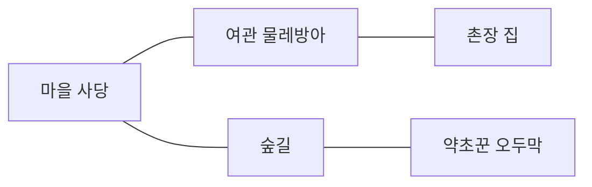

# 첫 이야기

**처음 만들 이야기 하나의 설계**다. 앞의 규칙이 실제로 돌아가는지 보는 것이 목적이다. 형식은 [08-story.md](08-story.md)를, 짜는 순서는 [09-authoring.md](09-authoring.md)를 따른다. 문장은 파일로 옮길 때 다듬는다.

**이 문서는 진실을 모두 적는다. 해 볼 사람은 읽지 않는다.**

## 한눈에

- 제목(가제): **새벽 종이 울리기 전에** — 김봉식 시리즈 1편
- 프로레슬러 김봉식이 트럭에 치여 중세 판타지 세계에 떨어진다. 숲길을 걷다 시체를 발견하고, 쫄쫄이 타이츠에 챔피언 벨트를 찬 차림 탓에 살인범으로 몰린다.
- 촌장이 선언한다. "새벽 종이 울리면 영주의 기사들에게 넘긴다." 김봉식은 감시를 받으며 그때까지 결백을 밝혀야 한다.
- 분위기: 김봉식의 차림과 말투는 웃기고, 사건은 진지하다.
- 이름: 김봉식은 한국식, 나머지는 서양 판타지식.
- 사람 다섯, 곳 다섯, 막힘 일곱, 번진 일 둘. 한 판 24칸. 한 칸은 이십 분, 밤 여덟 시에 시작해 새벽 네 시 종으로 끝난다.

## 1. 진실

| 물음 | 진실 |
|---|---|
| **누가** | 촌장 고드릭 |
| **어떻게** | *독미나리 독* |
| **왜** | *빼돌린 세금* |

**전말**: 고드릭은 세 해 동안 영주에게 바칠 세금을 덜 올리고 차액을 빼돌렸다. 오늘 해 질 녘 영주의 징수관 에드윈이 마을에 와서, 여관에 들렀다가 밤에 장부를 맞추러 촌장 집에 갔다. 장부가 맞지 않자 고드릭은 독미나리를 탄 술을 대접했다. 에드윈이 죽자 고드릭은 시신을 수레에 실어 숲길에 버렸다. 산적 짓으로 보이게 하려던 것이다. 목의 자국은 그때 수레 끈에 쓸려 생겼다. 그 길로 김봉식이 떨어졌고, 고드릭은 그를 범인으로 몰았다.

**겉 이야기**: 쫄쫄이를 입은 거구의 이방인이 숲길에서 징수관의 목을 졸랐다. 징수관 품의 명령서가 이방인을 잡으러 왔다고 말하니, 동기도 있다.

**시각표**

| 때 | 고드릭 | 에드윈 | 그 밖 |
|---|---|---|---|
| 해 질 녘 (여섯 시) | 집에서 장부를 꺼내 둔다 | 마을에 닿아 여관 '물레방아'에 들른다. 밀주를 보고 브람에게 은화를 받는다. 가방을 여관에 맡긴다 | 넬 할멈이 여관 쪽으로 가는 에드윈을 본다 |
| 저녁 (일곱 시) | 에드윈에게 술을 대접한다. 장부가 맞지 않는다 | 촌장 집에서 장부를 맞춘다 | 마렌은 부엌에서 잔 둘을 내간다. 사당은 비어 있다. 토빈이 사당 앞을 지나며 불이 꺼진 것을 본다 |
| 밤 (일곱 시 반) | 수레로 시신을 숲길에 옮긴다. 따라온 집 개는 짖지 않는다 | 죽는다 | 숯가마의 아버지에게 저녁을 나르던 토빈이 숲길로 나가는 촌장 댁 수레를 본다 |
| 밤 (여덟 시 조금 전) | 마을로 돌아와 사당에 있던 척한다 | | 마렌이 마당에서 진흙 묻은 수레를 본다. 김봉식이 숲길에 떨어져 시신을 발견하고, 토빈의 외침에 마을 사람들이 몰려온다 |
| 여덟 시 (판 시작) | 사당에서 김봉식을 붙잡아 두고 새벽 종까지를 선언한다 | | 마렌은 아버지가 저녁 내내 사당에 있었다고 말한다 |

## 2. 반전

| 단계 | 플레이어가 믿는 것 | 뒤집는 것 | 수(09 3절) |
|---|---|---|---|
| 시작 | 김봉식이 목을 졸랐다고 모두 믿는다 | 레슬러인 김봉식만은 첫눈에 조른 자국이 아님을 안다. 넬 할멈의 꺼림이 풀리면 목 자국은 죽은 뒤의 것이고 사인은 독이다 | 보이는 사인이 아니다 |
| 반전 1 | 술을 파는 브람이 독을 탔다. 그는 징수관이 여관에 오지 않았다고 거짓말한다 | 깨면 밀주와 뇌물이 드러나고, 징수관이 촌장 집으로 갔다는 말이 나온다 | 모두에게 비밀이 있다 |
| 반전 2 | 징수관은 촌장 집에 갔는데 시신은 숲길에 있다 | 바퀴 자국과 마른 장화, 그리고 토빈의 "개가 안 짖었다" | 현장이 옮겨졌다, 일어나지 않은 일 |
| 반전 3 | 마렌은 아버지가 사당에 있었다고 한다 | 아버지를 감싸는 거짓말이다. 깨면 집에 잔이 둘 남아 있었다고 한다 | 감싸는 거짓말 |
| 진실 | 김봉식을 붙잡은 고드릭이 범인이다 | "해 지기 전에 떠났다"가 깨지면 "멀쩡히 걸어 나갔다"가 나오고, 그것도 깨지면 시신을 옮긴 것까지 털어놓는다. 잠긴 궤짝 속 두 벌의 장부 | 범인은 가장 먼 사람, 시각이 틀렸다 |

## 3. 사실

| 이름 | 사실 |
|---|---|
| *독미나리 독* | 에드윈은 독미나리 독으로 죽었다 |
| *빼돌린 세금* | 고드릭은 세 해 동안 영주에게 바칠 세금을 빼돌렸다 |
| *촌장 집의 밤손님* | 에드윈은 밤에 촌장 집에 갔다 |
| *여관의 징수관* | 에드윈은 해 질 녘 여관에 들렀다 |
| *빈 사당* | 저녁 내내 사당에는 아무도 없었다 |
| *옮겨진 시신* | 에드윈은 숲길이 아닌 곳에서 죽었고, 시신은 수레로 옮겨졌다 |
| *밤에 나간 수레* | 촌장 집 수레가 밤에 숲길로 나갔다 |
| *조른 자국이 아니다* | 에드윈의 목 자국은 손으로 조른 자국이 아니다 |

## 4. 곳과 볼 것

| 곳 | 볼 것 | 보여 주는 사실 | 알리는 것 |
|---|---|---|---|
| **마을 사당** (시작) | 제단의 초가 하나도 타지 않은 채 그대로였다 | *빈 사당* | |
| **숲길** | 징수관의 목에 끈에 졸린 듯한 자국이 있었다 | 없다 (헛다리) | |
| | 목 자국에 손가락 자국이 없었다. 조른 것이 아니라 가는 끈이 한쪽으로 쓸고 간 자국이었다 | *조른 자국이 아니다* | |
| | 징수관의 입술이 검푸르게 변해 있었다 | *독미나리 독* | |
| | 진흙길인데 징수관의 장화 바닥은 말라 있었다 | *옮겨진 시신* | |
| | 마을 쪽에서 온 수레 바퀴 자국이 시신 앞에서 끊겨 있었다 | *옮겨진 시신* | |
| | 징수관의 허리띠에 여관 '물레방아'의 나무패가 달려 있었다 | *여관의 징수관* | 여관 물레방아 |
| | 징수관의 품에 영주의 명령서가 있었다. "하늘에서 떨어진 자를 찾아 데려오라" | 없다 (헛다리, 다음 편의 실마리) | |
| **여관 물레방아** | 쇠꼬챙이 (물건. 성질: 가늘고 단단하다) | | |
| | 징수관이 맡긴 가방에 쪽지가 있었다. "하스브룩 장부, 세 해 치가 모자람" (나오는 조건: 브람의 깨진 뒤 말이 수첩에 있다) | *빼돌린 세금* | |
| **촌장 집** | 장부 궤짝이 잠겨 있었다 (**잠김**) | | |
| | └ 안: 숫자가 서로 다른 장부 두 벌이 있었다 | *빼돌린 세금* | |
| **약초꾼 오두막** | 약초 칼 (물건. 성질: 가늘고 단단하다) | | |

- 목 자국의 두 번째 줄은 김봉식이 레슬러로서 알아보는 대목이다. 장면은 그가 수없이 조르고 졸려 본 목을 떠올리며 자국을 살피는 모습으로 그린다. 마을 사람들은 들은 척도 하지 않는다.
- 장부 궤짝 — 약점: 가늘고 단단하다. 주인: 고드릭. 단단하다. 실마리: "자물쇠 구멍이 좁다. 가는 쇠붙이라면 돌아가겠다."

## 5. 사람

처음 태도는 모두 믿음 보통, 두려움 보통이다. 마을 사람들은 김봉식을 살인범으로 알기에 브람과 넬은 믿음이 낮다.

### 고드릭 — 촌장 (마을 사당)

예순 가까운 촌장. 너그러운 척 점잖게 말하고, "마을을 위해서"를 입에 달고 산다.

| 화제 | 자세 | 할 말 | 보여 주는 사실 | 알리는 것 | 묻는 말 |
|---|---|---|---|---|---|
| 징수관 | **거짓말한다** | 거짓말: 징수관은 해 지기 전에 장부만 걷고 바로 떠났다. 깨진 뒤: 밤에 집에서 장부를 맞췄다. 수고했다고 술을 한잔 냈다 | 깨진 뒤: *촌장 집의 밤손님* | 깨진 뒤: 촌장 집 | 징수관을 마지막으로 본 게 언제입니까? / 징수관은 무슨 일로 마을에 왔습니까? |
| 그 뒤의 일 | **거짓말한다** | 거짓말: 그는 술을 마시고 멀쩡히 걸어 나갔다. 깨진 뒤: 그가 내 집에서 쓰러졌다. 내가 수레에 실어 숲길에 두었다 | 깨진 뒤: *옮겨진 시신* | 깨진 뒤: 숲길 | 술을 마신 뒤에 징수관은 어떻게 됐습니까? |
| 새벽 종 | 숨기지 않는다 | 새벽 네 시 종이 울리면 영주의 기사들이 온다. 그때까지 결백을 보이지 못하면 넘길 수밖에 없다 | | | 새벽 종이 울리면 어떻게 됩니까? |
| 마을 살림 | 숨기지 않는다 | 하스브룩은 가난한 마을이다. 올해는 보리마저 흉년이었다 | | | 마을 형편은 어떻습니까? |

- 징수관 — 깨는 사실: *촌장 집의 밤손님*
- 그 뒤의 일 — 깨는 사실: *밤에 나간 수레*. 나오는 조건: 고드릭의 "징수관" 깨진 뒤 말이 수첩에 있다.

### 마렌 — 촌장의 딸 (촌장 집)

스물 남짓. 아버지를 믿고 따르며, 말끝을 흐리는 버릇이 있다.

| 화제 | 자세 | 할 말 | 보여 주는 사실 | 알리는 것 | 묻는 말 |
|---|---|---|---|---|---|
| 아버지의 저녁 | **거짓말한다** | 거짓말: 아버지는 저녁 내내 사당에서 기도하셨다. 깨진 뒤: 징수관 나리가 집에 오셨었다. 내가 잔 둘을 내갔다 | 깨진 뒤: *촌장 집의 밤손님* | | 아버지는 저녁에 어디 계셨습니까? |
| 집안일 | 숨기지 않는다 | 오늘은 수레 쓸 일이 없었는데, 아까 마당에 나가 보니 바퀴에 진흙이 잔뜩 묻어 있었다 | *밤에 나간 수레* | | 오늘 집에 별일은 없었습니까? |

- 아버지의 저녁 — 깨는 사실: *빈 사당*

### 브람 — 여관 '물레방아' 주인 (여관)

마흔 줄. 배가 나오고 목소리가 크며, 손님 비위를 잘 맞춘다. "~소"로 끝맺는다.

| 화제 | 자세 | 할 말 | 보여 주는 사실 | 알리는 것 | 묻는 말 |
|---|---|---|---|---|---|
| 징수관 | **거짓말한다** | 거짓말: 징수관은 우리 여관에 오지도 않았다. 깨진 뒤: 밀주를 들켜서 은화를 쥐여 줬다. 그는 장부를 맞추러 촌장 댁에 간다며 가방을 맡겼다 | 깨진 뒤: *촌장 집의 밤손님* | 깨진 뒤: 촌장 집, 고드릭 | 징수관이 오늘 여관에 들렀습니까? |
| 독미나리 | 숨기지 않는다 | 이 근방에서 독미나리를 다룰 줄 아는 건 넬 할멈뿐이다 | 없다 (헛다리) | 넬 | 독초를 다룰 줄 아는 사람이 있습니까? |

- 징수관 — 깨는 사실: *여관의 징수관*
- 독미나리 — 나오는 조건: 검푸른 입술의 줄이 수첩에 있다.

### 넬 — 약초꾼 할멈 (약초꾼 오두막)

일흔이 넘었다. 퉁명스럽고, 촌장의 눈치를 본다. 시신을 처음 살펴본 사람이다.

| 화제 | 자세 | 할 말 | 보여 주는 사실 | 알리는 것 | 묻는 말 |
|---|---|---|---|---|---|
| 시신 | **꺼린다** | 풀린 뒤: 목 자국에 피멍이 없으니 죽은 뒤에 생긴 것이다. 입술이 검푸른 걸 보니 독미나리다 | *독미나리 독* | | 시신을 살펴보셨습니까? / 죽은 사람은 어땠습니까? |
| 해 질 녘 | 숨기지 않는다 | 해 질 녘에 징수관이 여관 쪽으로 가는 걸 봤다 | *여관의 징수관* | 여관 물레방아 | 오늘 저녁에 징수관을 보셨습니까? |
| 독미나리 | 숨기지 않는다 | 독미나리는 술에 타면 맛이 감쪽같다. 지난달 쥐를 잡는다며 촌장이 한 줌 얻어 갔다 | | 고드릭 | 독미나리에 대해 아십니까? |

- 시신 — 바라는 것: *옮겨진 시신*. 실마리: "그 사람이 거기서 죽었다고 누가 그러던가?"
- 독미나리 — 나오는 조건: 검푸른 입술의 줄이 수첩에 있다. 촌장의 눈치를 보는 넬은 독을 먼저 꺼내지 않는다.

### 토빈 — 나무꾼의 아들 (숲길)

열두 살. 저녁마다 숲속 숯가마의 아버지에게 저녁을 나른다. 돌아오는 길에 시신을 처음 보고 소리친 아이다. 겁이 많지만 본 것은 다 기억한다.

| 화제 | 자세 | 할 말 | 보여 주는 사실 | 알리는 것 | 묻는 말 |
|---|---|---|---|---|---|
| 사당 | 숨기지 않는다 | 저녁 일곱 시쯤 사당 앞을 지났는데 안이 깜깜했다 | *빈 사당* | 마을 사당 | 저녁에 사당 쪽에 가 봤니? |
| 숲길에서 본 것 | **꺼린다** | 풀린 뒤: 밤에 촌장님 댁 수레가 숲길로 나갔다. 그 집 개가 따라가는데 한 번도 안 짖었다 | *밤에 나간 수레* | 촌장 집 | 숲길에서 뭘 봤니? / 그날 밤 숲에서 무슨 일이 있었니? |

- 숲길에서 본 것 — 바라는 것: *조른 자국이 아니다*. 실마리: "아저씨가 목을 조른 게 아니라면 말할게요."

## 6. 막힘 일곱

4절과 5절에서 뽑은 표다. 길을 눈으로 확인하려고 둔다. 기계 검사가 생기면 지운다.

| 막힘 | 맞는 단서 | 열리면 |
|---|---|---|
| 고드릭의 거짓말 "해 지기 전에 떠났다" | 브람의 깨진 뒤 말(여관), 마렌의 깨진 뒤 말(촌장 집) | 징수관은 밤에 촌장 집에 있었다. 화제 "그 뒤의 일"가 나온다 |
| 고드릭의 거짓말 "멀쩡히 걸어 나갔다" | 토빈의 "숲길에서 본 것"(숲길), 마렌의 "집안일"(촌장 집) | 고드릭이 시신을 옮겼다 |
| 마렌의 거짓말 "아버지는 사당에" | 타지 않은 초(사당), 토빈의 "사당이 깜깜했다"(숲길) | 잔 둘. 징수관이 집에 왔었다 |
| 브람의 거짓말 "여관에 오지도 않았다" | 여관 나무패(숲길), 넬의 "해 질 녘"(오두막) | 밀주와 뇌물. 징수관은 촌장 집으로 갔다. 맡긴 가방의 쪽지 |
| 넬의 꺼림 "시신" | 마른 장화, 바퀴 자국(숲길) | 사인은 독미나리다. 화제 "독미나리"가 넬과 브람에게 나온다 |
| 토빈의 꺼림 "숲길에서 본 것" | 손가락 자국 없는 목(숲길) | 촌장 댁 수레가 밤에 숲길로 나갔다 |
| 장부 궤짝의 잠김 | 쇠꼬챙이(여관), 약초 칼(오두막) | 장부 두 벌 |

- 넬과 토빈의 꺼림은 모두 숲길의 본 것만으로 열린다. 토빈은 김봉식이 스스로 알아본 줄로 열린다. 누명을 쓴 사람이 자기 눈으로 아이의 마음을 연다.
- 독이 드러나면 브람의 말이 넬을 가리킨다(헛다리). 넬의 말은 촌장을 가리킨다.

## 7. 번진 일

| 때 | 일 | 막는 조건 | 조짐 |
|---|---|---|---|
| 10칸째 | 고드릭이 궤짝의 장부를 아궁이에 태운다. 장부 두 벌을 더는 볼 수 없다 | 마렌의 거짓말을 깼다 | 촌장 집 굴뚝에서 연기가 오르기 시작한다 |
| 16칸째 | 토빈이 아버지를 따라 산 너머 숯가마로 떠난다 | 토빈의 꺼림을 풀었다 | 숲 쪽에서 토빈을 부르는 아버지의 목소리가 들린다 |

- 7칸째의 조짐은 고드릭이 마렌에게 아궁이 불을 지피라 이른 것이다. 10칸째에 고드릭이 사당을 떠나 촌장 집으로 옮기고 장부를 태운다. 막았으면 고드릭은 사당에 남는다.
- 장부가 타도 *빼돌린 세금*은 여관에 맡긴 가방의 쪽지로 얻을 수 있다.
- 꺼림이 풀린 토빈은 김봉식을 믿게 되어, 기사들 앞에서 말하겠다며 마을에 남는다.
- 토빈이 떠나도 *빈 사당*은 타지 않은 초로, *밤에 나간 수레*는 마렌의 "집안일"로 얻을 수 있다.
- 마렌의 거짓말이 깨지면 마렌은 아버지를 의심하기 시작하고, 장부 궤짝을 지킨다. 그래서 장부가 타지 않는다.

## 8. 결말

| 결말 | 대목 |
|---|---|
| 다 밝혔다 | 새벽 종과 함께 온 기사들 앞에서 김봉식이 수첩을 편다. 독미나리, 빼돌린 세금, 그리고 촌장의 이름 |
| 누구인지는 밝혔다 | 김봉식이 촌장을 지목하지만 수법이나 까닭이 비어 있다. 기사들은 둘을 함께 묶어 간다 |
| 엉뚱한 사람을 짚었다 | 당신이 짚은 사람이 끌려가고, 촌장은 고개를 숙여 기사들을 배웅한다 |
| 밝히지 못했다 | 김봉식은 쫄쫄이 차림 그대로 기사들에게 끌려간다 |

번진 일의 대목은 결론과 무관한 일만 쓴다.

| 번진 일 | 벌어졌을 때 | 막았을 때 |
|---|---|---|
| 장부가 탄다 | 촌장 집 아궁이에 재가 수북하다 | 마렌이 궤짝을 안고 기사들 앞에 선다 |
| 토빈이 떠난다 | 산길 위로 나무꾼 부자의 등불이 멀어진다 | 토빈이 김봉식의 벨트를 신기한 듯 만져 본다 |

**진실 풀이** 끝에 다음 편의 실마리를 한 줄 남긴다. 징수관이 지닌 명령서의 "하늘에서 떨어진 자"는 누구이고, 영주는 왜 그를 찾는가.

## 9. 주사위 없이 가는 길

길 하나를 따라가 본다. 옮기기 여섯 칸, 장부가 타는 10칸째 전에 촌장 집에 닿는다. 더 짧은 길도 있다.

1. 마을 사당: 고드릭에게 징수관을 묻는다. (거짓말을 듣는다) 타지 않은 초를 본다.
2. 숲길: 볼 것을 모두 본다. 토빈에게 사당을 묻는다. 손가락 자국 없는 목을 내밀어 토빈의 꺼림을 푼다. 밤에 나간 수레.
3. 약초꾼 오두막: 넬에게 바퀴 자국을 내밀어 꺼림을 푼다. 독미나리. 약초 칼을 얻는다.
4. 숲길, 마을 사당을 지나 여관: 브람에게 여관 나무패를 내민다. 징수관은 촌장 집으로 갔다. 가방의 쪽지.
5. 촌장 집: 마렌에게 타지 않은 초를 내민다. 잔 둘. 약초 칼로 궤짝을 연다. 장부 두 벌.
6. 결론: 고드릭 / 검푸른 입술 / 장부 두 벌이나 쪽지.

고드릭의 거짓말 둘은 결론에 꼭 깨지 않아도 된다. 깨려면 고드릭이 있는 곳(사당. 장부가 탔으면 10칸째부터 촌장 집)에서 브람이나 마렌의 말을 내밀고, 이어 토빈이나 마렌의 수레 이야기를 내민다.

## 10. 이 이야기로 볼 것

- 반전 네 번이 차례로 느껴지는가. 처음에 김봉식이 범인처럼 보이는가.
- 목 자국을 알아보는 대목이 김봉식다운 순간으로 느껴지는가. 그 줄을 토빈에게 내밀 생각이 드는가.
- 브람을 범인으로 의심하게 되는가. 깨진 뒤 촌장 쪽으로 눈이 가는가.
- 넬과 토빈이 서로를 바라는 것이 막막하지 않은가.
- 넬의 "촌장이 독미나리를 얻어 갔다"를 결론의 어떻게로 고르는가. 많이 고르면 08 5절대로 사실을 붙이거나 말을 고친다.
- 고드릭이 처음부터 곁에 있는데도 의심이 늦게 가는가. 쪽지를 여관에 둔 것은 이 때문이다. 시신에 있으면 첫 장면에 촌장이 드러난다.
- 독미나리가 드러난 뒤 넬을 한 번 의심하게 되는가.
- 한 판이 1시간 안팎에 끝나는가. 24칸이 넉넉한가, 모자란가.
- 작은 AI가 김봉식을 대하는 다섯 사람을 서로 다른 목소리로 말하게 하는가.
