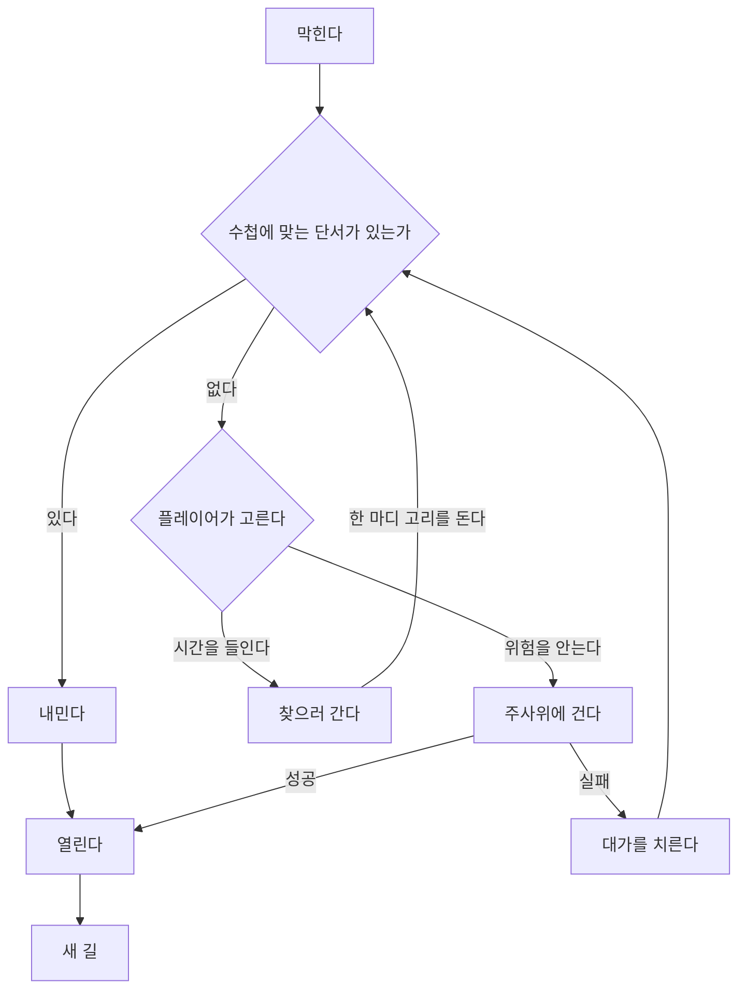
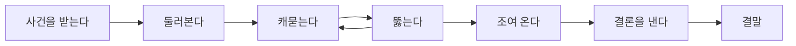

# 핵심 루프

**플레이어가 무엇을 반복하는가**만 정한다. 각 단계의 규칙은 뒤의 문서가 정한다. 낱말은 [01-concept.md](01-concept.md)를 따른다.

## 한눈에

플레이어는 세 겹의 고리를 돈다. 작은 고리가 여러 번 돌아 큰 고리 하나가 된다.

| 고리 | 길이 | 하는 일 | 정하는 것 | 얻는 것 |
|---|---|---|---|---|
| **한 마디** | 30초 | 쓰고, 듣는다 | 누구에게 무엇을 물을까 | 수첩 한 줄 |
| **막힘 하나** | 5분 | 막힌 곳을 뚫는다 | 내밀까, 찾으러 갈까, 걸까 | 새로 열린 길 |
| **한 판** | 40분 | 사건을 밝힌다 | 어디에 시간을 쓸까, 언제 결론을 낼까 | 결말 |

고리마다 플레이어가 **정하는 것**이 있어야 한다. 정할 것이 없는 구간은 놀이가 아니라 기다림이다.

## 1. 한 마디 (30초)

사람과 말을 주고받는 느낌이어야 한다. 대화가 끊기지 않는다.

- **쓰면 반드시 대답이 온다.** 수첩에 적힐 것이 없어도 그 사람은 대답한다.
- **수첩이 바뀌면 바로 보인다.** 새 줄이 한 마디의 보상이다.
- **기다림은 짧다.** 대답이 시작되기까지 몇 초를 넘지 않는다.

## 2. 막힘 하나 (5분)

누군가 거짓말을 하거나, 말을 아끼거나, 어딘가 잠겨 있다.

| 길 | 드는 것 | 얻는 것 |
|---|---|---|
| 맞는 단서를 내민다 | 대가 없음 | 반드시 열린다 |
| 찾으러 간다 | 시간 | 단서가 늘 수 있다. 다른 막힘의 열쇠가 같이 나오기도 한다 |
| 주사위에 건다 | 실패의 대가 | 지금 바로 열릴 수도 있다 |

- **수첩을 보며 궁리하는 순간**이 이 게임에서 머리를 가장 많이 쓰는 때다.
- **찾으러 갈지 걸지는 플레이어가 정한다.** 규칙이 가르지 않는다. 이 게임의 중심 결정이다.
- **주사위로는 거짓말이 깨지지 않는다.** 거짓말은 단서로만 깬다. 거짓말 앞에서 주사위에 걸면 무엇이 돌아오는지는 막힘과 주사위 문서가 정한다.
- **열리면 넓어진다.** 새 화제, 새 장소, 새 단서 중 하나 이상이 나오고, 그것이 다음 막힘으로 이어진다.

지켜야 할 것:

- **막힌 줄을 안다.** 입이 무거운 것과 잠긴 것은 플레이어가 알 수 있다. 거짓말은 알려 주지 않는다. 플레이어가 어긋남으로 알아챈다.
- **갈 곳이 늘 하나는 있다.** 모든 길이 한 막힘에 걸리지 않는다.
- **틀려도 빈손은 아니다.** 무엇이 남는지는 막힘과 주사위 문서가 정한다.

시간이 얼마나 드는지는 시간과 결론 문서가 정한다.

## 3. 한 판 (40분)

보통의 흐름이다. 결론은 어느 칸에서든 낼 수 있다.

| 구간 | 길이 | 플레이어가 하는 일 | 느낌 |
|---|---|---|---|
| **시작** | 3분 | 사건을 듣고, 누가 있고 어디에 갈 수 있는지 안다 | 궁금하다 |
| **둘러보기** | 10분 | 사람을 만나고 곳곳을 살핀다. 수첩이 빠르게 찬다 | 넓어진다 |
| **파고들기** | 20분 | 어긋나는 것을 찾고 막힘을 뚫는다. 사건이 번진다 | 조여 온다 |
| **결론** | 5분 | 수첩을 펴고 누가, 어떻게, 왜를 낸다 | 건다 |
| **결말** | 2분 | 무엇을 밝혔고 그동안 무엇이 번졌는지 본다 | 풀린다 |

지켜야 할 것:

- **처음 3분 안에 손이 간다.** 긴 설명 없이 첫 질문을 쓸 수 있다.
- **수첩이 찰수록 할 일이 또렷해진다.** "무엇을 더 찾지?"가 "이걸 누구에게 내밀지?"로 바뀐다.
- **끝은 플레이어가 낸다.** 다 됐다고 느끼는 순간 결론을 낸다.
- **언제 결론을 내도 결말이 있다.** 다 밝히지 못해도 한 판은 이야기로 끝난다.

## 4. 긴장은 시간에서 온다

- **캐묻는 것은 싸고, 헛걸음은 비싸다.**
- 시간이 가면 사건이 번진다. 예컨대 누군가 달아나거나 다친다.
- 그래서 뒤로 갈수록 같은 선택이 무거워진다. "한 군데 더 가 볼까"가 처음에는 공짜 같고 끝에는 도박이 된다.

## 5. 고리가 끊기는 곳

플레이어가 그만두는 순간은 대개 이 셋이다. 뒤의 문서는 이것을 막는 쪽으로 정한다.

| 끊기는 곳 | 모습 | 막는 방향 |
|---|---|---|
| **막막함** | 무엇을 해야 할지 모른다 | 입이 무거운 사람, 잠긴 곳, 아직 안 가 본 곳을 보여 준다 |
| **기다림** | 대답이 늦다 | 짧게 말한다 |
| **헛돎** | 써도 아무것도 안 바뀐다 | 같은 말을 되풀이하면 그 사람이 달리 반응하거나 다른 데를 가리킨다 |

## 6. 크기 (가정)

한 판 40분에서 나온 어림이다. **해 보지 않은 숫자다.** 첫 이야기를 돌려 보고 고친다.

| 무엇 | 크기 | 근거 |
|---|---|---|
| 한 마디 | 70~90번 | 30초씩 40분 |
| 막힘 | 7~9개 | 하나에 5분 |
| 사람 | 4~5명 | 한 사람에 막힘 하나나 둘 |
| 장소 | 4~6곳 | 옮길 때마다 시간이 가므로 적게 |
| 번진 일 | 2~3번 | 파고들기 구간에 고르게 |

## 뒤의 문서에 넘기는 것

| 무엇 | 어느 문서 |
|---|---|
| 입이 무거운 사람, 잠긴 곳, 안 가 본 곳을 어디서 어떻게 보여 주는가 | 낱말과 수첩, 화면 |
| 사람이 같은 물음에 어떻게 달리 반응하는가 | 대화 |
| 실패의 대가가 무엇인가 | 막힘과 주사위 |
| 시간의 단위와 드는 양, 번진 일이 벌어지는 때, 결말의 종류 | 시간과 결론 |
